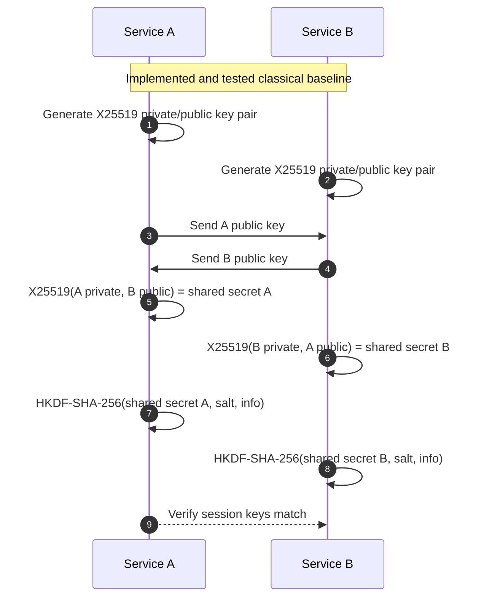
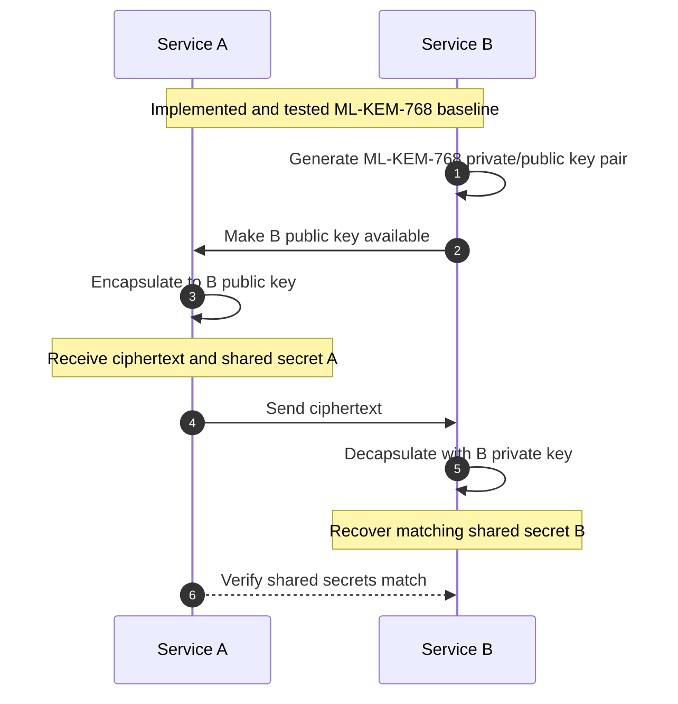
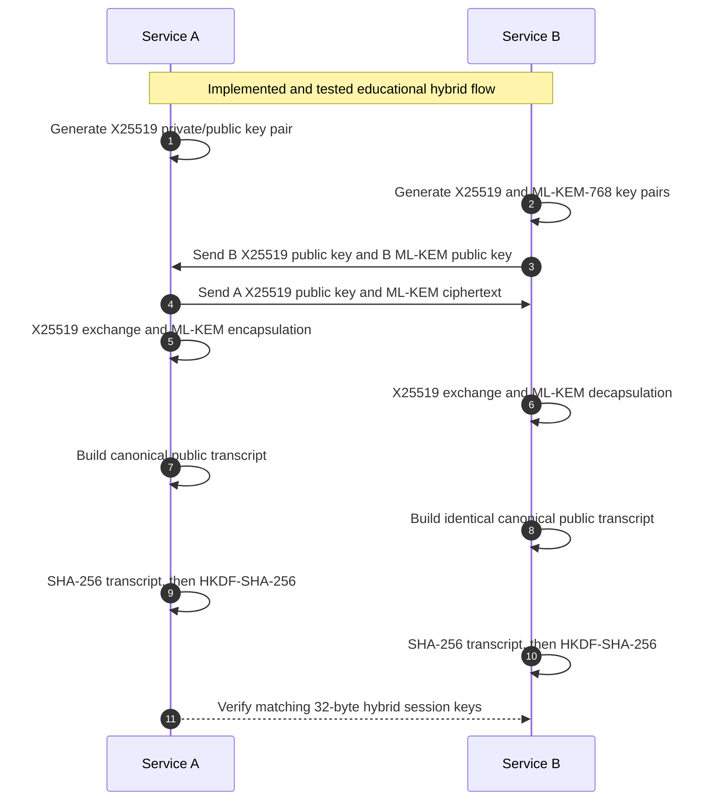

# Proposed Hybrid Key-Exchange Architecture

> **Status: mixed implementation and proposal.** The independent classical
> X25519/HKDF and post-quantum ML-KEM-768 components, plus the educational
> hybrid combiner described below, are implemented and tested. Authentication
> and deployment remain planned. This is not an implemented or deployed
> production system.

## Parties and responsibilities

- **Service A** is the initiating workload. It generates an ephemeral X25519
  key pair and uses Service B's ML-KEM-768 public key to encapsulate a shared
  secret.
- **Service B** is the responding workload. It generates an ephemeral X25519
  key pair and an ML-KEM-768 key pair, then makes both public keys available
  for the hybrid exchange.
- **The authenticated transport/control plane** is responsible for identity,
  authorization, replay protection, transcript binding, and policy checks. A
  KEM alone does not provide all of those properties.

## Proposed workflow

```mermaid
sequenceDiagram
    autonumber
    participant A as Service A
    participant B as Service B
    participant Z as Zero-Trust control plane

    Note over A,B: Proposed design; not implemented or deployed
    A->>Z: Request connection and present workload identity
    Z-->>A: Policy decision and authenticated peer metadata
    A->>B: Send X25519 public key and ML-KEM-768 ciphertext
    B->>B: X25519 exchange with A's public key
    B->>B: ML-KEM-768 decapsulation
    B-->>A: Send X25519 public key and authenticated response
    A->>A: X25519 exchange
    A->>A: Retain ML-KEM shared secret
    Note over A,B: Both sides derive the same session key with HKDF
    A<<->>B: Future AEAD-protected application traffic
```

The exact message order, authentication mechanism, transcript fields, error
handling, and key confirmation are intentionally deferred until the protocol
design is reviewed. Public values must be authenticated and bound to the
intended peers and context; simply concatenating values is not a complete
protocol.

## Implemented Day 2 classical baseline

The repository now contains a runnable educational flow for Service A and
Service B:



`src/classical_ecdh.py` implements key-pair generation, typed public-key
exchange, X25519 shared-secret derivation, and 32-byte HKDF-SHA-256 session-key
derivation. `scripts/demo_ecdh.py` exercises both simulated services without
printing key material, and `tests/test_ecdh.py` covers agreement, context
separation, reproducibility, independent exchanges, and invalid inputs.

X25519 and HKDF are implemented for this classical baseline. The demonstration
does not authenticate either service; certificates or an authenticated TLS or
application protocol are still required for protection against active
man-in-the-middle attacks.

## Implemented Day 3 ML-KEM-768 baseline

The repository also contains an independent, tested ML-KEM-768 KEM flow. It
uses the installed `cryptography` backend rather than reimplementing ML-KEM
mathematics. Service B keeps its private key local; the public key and
ciphertext are the only values made available to the other simulated service.



`src/pqc_mlkem.py` provides typed key generation, encapsulation, and
decapsulation functions. `scripts/demo_mlkem.py` demonstrates the two-service
flow without printing secret material, and `tests/test_mlkem.py` verifies
agreement, independent exchanges, library-consistent malformed-input behavior,
implicit rejection, and sanitized normal output. A same-length altered ML-KEM
ciphertext can yield a replacement secret through implicit rejection; this
behavior does not authenticate the ciphertext.

## Implemented Day 4 hybrid baseline

Day 4 composes the independent components without reimplementing either
algorithm. It aborts if X25519, ML-KEM, transcript construction, or final key
agreement fails; it never falls back to a single component.



`src/hybrid_exchange.py` length-prefixes the ordered X25519 and ML-KEM shared
secrets for HKDF input keying material. It length-prefixes the protocol and
algorithm identifiers, both X25519 public keys, Service B's ML-KEM public key,
and the ML-KEM ciphertext to form the canonical transcript. The SHA-256
transcript hash is a public HKDF salt, while the versioned hybrid context and
hash form HKDF `info`. Private keys and secrets are not placed in the
transcript or printed by `scripts/demo_hybrid.py`.

## Cryptographic roles

### X25519

X25519 is the classical elliptic-curve Diffie–Hellman component. Each party
creates an ephemeral private key, exchanges a public key, and computes the same
X25519 shared secret. The raw result should be passed into a key-derivation
function rather than used directly as an encryption key.

### ML-KEM-768

ML-KEM-768 is the post-quantum component standardized in NIST FIPS 203. It is
a **key-encapsulation mechanism (KEM)**: a recipient has a public/private key
pair, an initiator encapsulates to the public key to produce a ciphertext and
shared secret, and the recipient decapsulates the ciphertext to recover the
same shared secret.

ML-KEM is not a direct replacement for every part of TLS or for every use of
ECDH. It does not, by itself, authenticate a service identity, negotiate a
complete secure-channel protocol, enforce authorization, provide certificate
validation, or replace the symmetric authenticated encryption used for
application data. Those responsibilities remain part of the surrounding
protocol and zero-trust control plane.

## Educational hybrid HKDF combiner

Day 2 still demonstrates a session key derived from X25519 alone. Day 4 adds a
separate hybrid path with two component secrets, a canonical public transcript,
and a domain-separated HKDF derivation. The prototype intentionally does not
include peer identities, certificate validation, negotiated parameters, or key
confirmation, so it must be reviewed and replaced with a standardized protocol
before production use.

The derived session key could later feed an AEAD such as AES-GCM or
ChaCha20-Poly1305 for application data. Nonces, rekeying, key lifetime,
failure handling, and key erasure also require explicit protocol decisions.

## Relationship to the wider Kubernetes zero-trust project

This component is one cryptographic building block in the wider architecture:

- workload identity and certificate validation establish who is connecting;
- OPA and Kubernetes NetworkPolicies provide authorization and segmentation;
- Envoy or another service-mesh data plane can carry and observe the traffic;
- secrets management protects long-lived configuration and credentials;
- monitoring records policy and handshake outcomes without logging key material.

The hybrid key exchange must not bypass those controls. A successful
cryptographic handshake is not an authorization decision, and a policy
decision must not expose private keys or shared secrets to logs or telemetry.

## Implemented Day 5 benchmarking boundary

Day 5 measures the existing educational implementations without modifying
their cryptographic behavior. The benchmark uses a serial local process and
time.perf_counter_ns, performs warm-up iterations outside the recorded data,
and validates each flow before it starts timing.

The results distinguish isolated operations from complete exchanges:

- the classical complete exchange creates two X25519 key pairs, derives both
  ECDH secrets, and derives both HKDF session keys;
- the ML-KEM complete exchange creates a new ML-KEM-768 pair, encapsulates,
  and decapsulates;
- the hybrid complete exchange calls perform_hybrid_exchange, including its
  existing key generation, transcript construction, component agreement
  checks, and hybrid HKDF derivations.

The individual operation rows are intentionally not added together because
they overlap with the complete-exchange scope. Public payload accounting uses
the actual raw serialization sizes: two X25519 public keys for the classical
flow, an ML-KEM public key plus ciphertext for the KEM flow, and all four
public values for the hybrid flow. These are simulated cryptographic payload
sizes, not measured network traffic or total TLS handshakes.

The benchmark stores raw timing samples, summary statistics, public-size
metadata, and environment metadata in the results directory. It generates
separate latency and payload charts from the summary CSV, and writes a
measurement-specific report to docs/benchmark_report.md. No private key,
shared secret, or session key is written to any artifact.

## Implemented Day 6 integration boundary

`src/integration.py` is a narrow façade over the secret-bearing in-memory
`perform_hybrid_exchange()` result. It verifies both component agreements,
transcript presence, final session-key agreement, and the expected 32-byte
key length before returning a metadata-only `HybridSessionResult`.

The integration result includes the protocol version, X25519 and ML-KEM-768
algorithm identifiers, verified key length, local elapsed duration, and check
names. It deliberately excludes all private keys, raw component secrets,
transcript bytes, and final session-key bytes. Failures raise a sanitized
`HybridIntegrationError` with a safe error code; the façade never falls back
to a single algorithm.

The updated `scripts/demo_hybrid.py` depends on this façade rather than
directly presenting the low-level exchange result. Its two simulated services
remain entirely in process. No network listener, wire protocol, certificate,
TLS session, or service-mesh configuration is created by Day 6.

## Integration boundary with the wider project

The prototype is one input to a future design, not a replacement for the
other zero-trust layers:

- certificate validation must authenticate the workload identities;
- OPA must decide whether an authenticated request is authorized;
- Kubernetes NetworkPolicies must restrict allowed pod network paths;
- Envoy or another supported transport must provide standardized TLS/mTLS;
- monitoring must record only non-secret operational and security events.

Current Envoy documentation describes BoringSSL-backed
`X25519MLKEM768` support and named-group configuration. Any future deployment
must pin the exact Envoy version and TLS provider, validate that both peers
negotiate the intended group, configure certificate validation and mTLS, and
test failure behavior. That work has not been performed in this repository.
The detailed plan is in `docs/integration_guide.md`.

## Implementation boundary through Day 6

Day 1 verified that the local Python environment exposes X25519 and ML-KEM-768
through the selected `cryptography` package. Day 2 implements and tests the
classical X25519/HKDF baseline, Day 3 independently implements and tests the
ML-KEM-768 baseline, Day 4 implements an educational hybrid combiner, Day 5
adds reproducible local performance and payload measurements, and Day 6 adds a
safe application-facing metadata interface and end-to-end local demonstration.

Certificates, authenticated protocol integration, TLS or Envoy measurement,
Kubernetes deployment, OPA authorization, and any claim of production
post-quantum security remain out of scope.
