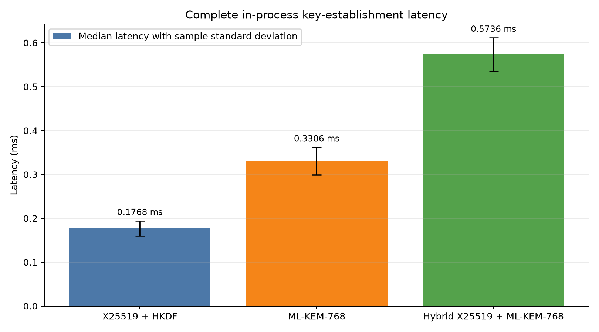
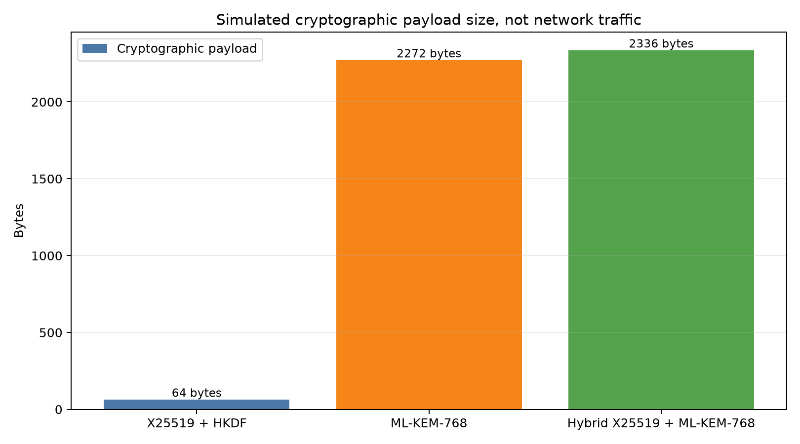

# Day 5 Benchmark Report

## Executive summary

This report preserves historical in-process Python cryptographic-operation measurements, not TLS handshakes, network, Envoy, or Kubernetes latency. No new performance run was performed for the 28 October reproduction. Recalculation from the preserved raw CSV confirmed 500 complete-exchange samples per mode and the medians in the table below. The local hybrid construction is unauthenticated and is not production TLS or mTLS.

This report contains actual local measurements collected on 2026-10-18T19:38:11+05:30.
X25519 + HKDF was the fastest complete exchange in this run at a 0.176800 ms median.
The hybrid complete exchange had a 0.396850 ms absolute median difference from the classical baseline (224.462670%).

## Experimental environment

| Item | Observed value |
| --- | --- |
| Timestamp | 2026-10-18T19:38:11+05:30 |
| Operating system | Windows-11-10.0.26300-SP0 |
| CPU model | Intel(R) Xeon(R) W-10855M CPU @ 2.80GHz |
| Architecture | AMD64 |
| Logical CPUs | 12 |
| Python | 3.13.12 |
| cryptography | 50.0.2 |
| ML-KEM implementation | cryptography.hazmat.primitives.asymmetric.mlkem.MLKEM768 |
| OpenSSL backend | OpenSSL 4.0.3 29 Sep 2026 |
| Matplotlib | 3.11.2 |
| Warm-up / measured iterations | 20 / 500 |

The cryptography package uses its installed backend; this benchmark records the exposed OpenSSL backend version but does not identify ML-KEM backend internals separately.

## Methodology

The timer is time.perf_counter_ns. Each benchmark first performs the documented warm-up count, then records serial samples without console output. The 95th percentile uses linear interpolation at index (n - 1) * 0.95, and standard deviation is the sample standard deviation.

A one-time correctness check for every implementation runs outside timed sections. Isolated operations use prebuilt valid inputs where appropriate so they measure the named operation. Complete exchanges create fresh key material and run the actual project flow: the classical path creates two X25519 pairs, performs both exchanges, and derives both HKDF keys; ML-KEM creates a pair, encapsulates, and decapsulates; the hybrid path calls perform_hybrid_exchange, including its existing transcript and agreement checks. Individual rows overlap with complete exchanges and must not be added together.

## Reproducing safely

The stored artifacts above are preserved reference measurements. To collect a
new 20-warm-up, 500-iteration local run without overwriting them, use a
separate ignored output directory:

```powershell
.\.venv\Scripts\python.exe scripts\benchmark.py --warmup 20 --iterations 500 --output-dir .tmp\benchmark-run --report-path .tmp\benchmark-report.md
.\.venv\Scripts\python.exe scripts\plot_benchmarks.py --summary-path .tmp\benchmark-run\benchmark_summary.csv --output-dir .tmp\benchmark-charts
```

On Linux/macOS, replace the interpreter path with `./.venv/bin/python` and
use forward-slash paths. The resulting data is a fresh local measurement and
should not be compared directly with this run without accounting for machine
and scheduling differences.

## Results

Latency values are milliseconds.

| Approach | Operation | Mean | Median | Std. dev. | Min | Max | P95 |
| --- | --- | --- | --- | --- | --- | --- | --- |
| X25519 + HKDF | x25519_key_generation | 0.044813 | 0.043900 | 0.003713 | 0.041400 | 0.079900 | 0.050205 |
| X25519 + HKDF | x25519_shared_secret_derivation | 0.036607 | 0.036300 | 0.002337 | 0.034300 | 0.058900 | 0.040205 |
| X25519 + HKDF | x25519_hkdf_session_key_derivation | 0.008007 | 0.007500 | 0.006904 | 0.007300 | 0.160200 | 0.008100 |
| X25519 + HKDF | complete_exchange | 0.182420 | 0.176800 | 0.017558 | 0.171300 | 0.317700 | 0.205825 |
| ML-KEM-768 | mlkem_768_key_generation | 0.225565 | 0.222650 | 0.027258 | 0.179900 | 0.370100 | 0.276535 |
| ML-KEM-768 | mlkem_768_encapsulation | 0.052698 | 0.051000 | 0.008140 | 0.045200 | 0.144400 | 0.067630 |
| ML-KEM-768 | mlkem_768_decapsulation | 0.075976 | 0.075500 | 0.010149 | 0.065400 | 0.156800 | 0.094400 |
| ML-KEM-768 | complete_exchange | 0.341442 | 0.330650 | 0.031419 | 0.289600 | 0.564200 | 0.388155 |
| Hybrid X25519 + ML-KEM-768 | hybrid_x25519_operations | 0.068535 | 0.066600 | 0.007702 | 0.062000 | 0.179400 | 0.081400 |
| Hybrid X25519 + ML-KEM-768 | hybrid_mlkem_encapsulation_and_decapsulation | 0.125095 | 0.122200 | 0.009540 | 0.116200 | 0.201200 | 0.143630 |
| Hybrid X25519 + ML-KEM-768 | hybrid_hkdf_combination | 0.035067 | 0.032900 | 0.006558 | 0.031200 | 0.121900 | 0.046040 |
| Hybrid X25519 + ML-KEM-768 | complete_exchange | 0.567967 | 0.573650 | 0.038415 | 0.471600 | 0.764200 | 0.620815 |

## Cryptographic payload sizes

These are in-memory simulated cryptographic payloads, not measured network traffic or total TLS handshake sizes. TLS framing, certificates, signatures, and protocol metadata are excluded.

| Approach | X25519 public key bytes x count | ML-KEM public key bytes x count | ML-KEM ciphertext bytes x count | Total bytes |
| --- | --- | --- | --- | --- |
| X25519 + HKDF | 32 x 2 | none | none | 64 |
| ML-KEM-768 | none | 1184 x 1 | 1088 x 1 | 2272 |
| Hybrid X25519 + ML-KEM-768 | 32 x 2 | 1184 x 1 | 1088 x 1 | 2336 |

Charts generated from the summary CSV:

- ../results/latency_comparison.png
- ../results/payload_size_comparison.png





## Performance interpretation

The separately measured operation with the highest median in this run was mlkem_768_key_generation for ML-KEM-768 at 0.222650 ms. That observation identifies an isolated cost, not an additive breakdown of the complete-exchange measurement.
Compared with X25519 + HKDF, the observed hybrid complete-exchange median changed by 0.396850 ms (224.462670%).
ML-KEM-768 increases the cryptographic payload because its public key and ciphertext are transmitted in addition to the two small X25519 public keys used by the hybrid flow.

## Relative overhead

Hybrid overhead percentage equals (hybrid median - classical median) / classical median * 100. Both values use the complete_exchange timing scope.

| Comparison | Absolute median difference (ms) | Relative overhead |
| --- | --- | --- |
| Hybrid versus X25519 + HKDF | 0.396850 | 224.462670% |

## Limitations

- Results are specific to this machine, OS, Python process, and installed libraries.
- Python wrapper and native-library overhead are both included.
- Local in-process measurements do not measure network latency, TLS, Envoy, or Kubernetes performance.
- The experiment does not establish formal cryptographic security, authentication, or production readiness.
- Scheduling, CPU frequency policy, and background tasks can introduce variation.

## Conclusion

The experiment provides a reproducible local comparison of the prototype's cryptographic operations and their payload trade-offs. It supports using these measurements to plan service-mesh integration, while authenticated protocol design and real deployment benchmarks remain necessary next steps.
