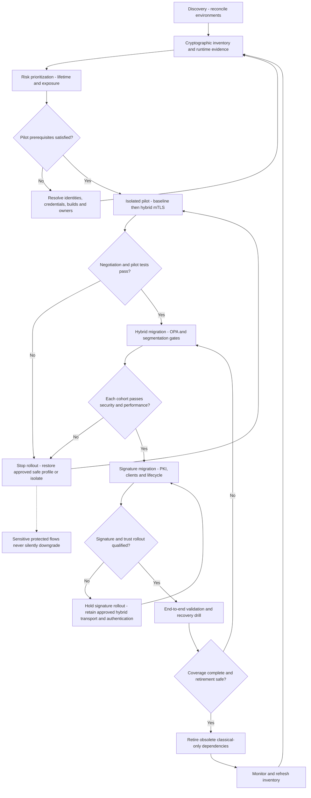

# Week 4, Person 3 — Enterprise PQC migration strategy

**Project:** Post-Quantum Zero-Trust Microsegmentation Mesh

**Programme:** Certification Program in Agentic Systems and Design, iHUB Divyasampark, IIT Roorkee

**Day 2 deliverable · Reviewed:** 23 November 2026 (Asia/Calcutta)

**Status:** Strategy and test design completed. All migration phases and T-series tests below are **PROPOSED / NOT EXECUTED**. Historical and live Day 1 findings are identified as evidence inputs. This report does not claim an operational PQC Kubernetes mesh. Day 3's final agility roadmap and presentation remain pending.

## 1. Executive summary

Migrate key establishment through an isolated, authenticated TLS 1.3 pilot, then migrate certificate signatures through a separately qualified PKI programme. Use the existing fixed-response `zt-integration` frontend/backend demonstration as the pilot template: its payload is synthetic and its TLS endpoints are identifiable. Create a separate test deployment with distinct identities and valid credentials before testing.

The proposed transport target is `X25519MLKEM768` on verified client/server TLS stacks, retaining certificate verification and mutual authentication. Classical RSA/ECDSA certificates can remain during this phase; authentication has then **not** migrated to post-quantum signatures. Evaluate ML-DSA separately across the issuer, chain, TLS handshake signature and every relying client. Evaluate SLH-DSA as an alternative signature family without assuming product support.

Three findings control implementation: current Kubernetes runtime capabilities are unverified; the OPA and NGINX mTLS examples are separate paths; and the locally verified Vault is healthy but has an expired default CA. Checked-in Secret backups also require owner-led credential exposure assessment before any credential is reused.

Success means measured authenticated hybrid connections on inventoried flows, preserved authorization/segmentation, a tested certificate lifecycle and a reversible rollout without unapproved downgrade. A successful handshake alone is insufficient. This assignment delivers the migration design without changing working infrastructure.

## 2. Existing architecture and enterprise assumptions

The [Day 1 assessment](week4_architecture_assessment.md), [inventory C01–C23](cryptographic_inventory.md) and [live Vault verification](../evidence/week4-person3-day1/vault-live/README.md) are the evidence baseline. The following are evidence summaries, not new live checks.

| Scope | Actual project | Hypothetical enterprise extension |
|---|---|---|
| Workloads | `zt-integration` curl frontend calls NGINX backend on 8443; fixed response and client-certificate requirement. Frontend sleeps and has no server listener despite its Service. | Multiple owned services with known data classes, traffic volumes, availability targets and external consumers. These properties must be collected. |
| Transport | Historical workload TLS 1.3/X25519/RSA certificates. Separate Envoy/OpenSSL experiments negotiated hybrid TLS. No verified in-cluster hybrid mTLS. | Controlled client/server upgrades, per-flow profiles and an explicit legacy exception register. |
| Authorization | `example-app` Envoy HTTP 8000 → app HTTP 8080, local OPA ext_authz, no configured transport TLS. Not proven to protect the NGINX mTLS request. | Trusted authenticated service identity supplied to authorization, with no route bypassing enforcement. |
| Segmentation | Namespace-specific NetworkPolicies. Older `zero-trust` frontend/backend/NGINX “database” demonstration. Current cluster/CNI enforcement unverified. | Verified ingress/egress boundaries. “Database” is not evidence of actual confidential records. |
| PKI/secrets | RSA workload certificate backups; distinct local Vault ECDSA P-256 CA; another historical `cert-demo` environment. Vault 2.2.1 was unsealed/active and authenticated during Day 1 checks. | Managed issuance, reissuance, trust distribution, revocation, audit and recovery under an identified PKI owner. |
| Vault limitation | Loopback HTTP API; default CA expired `2026-11-12T11:40:42Z`. AppRole configuration verified, not new issuance or Kubernetes integration. | Remote use needs approved TLS, reachable authentication and workload delivery. Localhost-bound AppRoles cannot simply be reused remotely. |
| Applications/metrics | Python is an in-process educational crypto prototype. Monitoring uses HTTP/self-scrape/sample events; negotiated-group coverage is absent. | Supported authenticated protocols, protected operational endpoints, meaningful telemetry and sustainable key lifecycle. |

**Illustrative data assumptions:** enterprise confidential customer/research information might require 5–10 years of secrecy; internal operational data months to a year; public/synthetic data no secrecy lifetime. These are proposed business assumptions, not project discoveries or legal retention periods. No production dataset, external business partner, HSM, enterprise SLA or compliance certification has been verified. Data owners must approve actual sensitivity and lifetime.

## 3. Migration objectives

| Objective | Proposed measurable completion condition |
|---|---|
| Discover dependencies | Every in-scope communication edge has an owner, data class/lifetime, actual client/server build and image digest, TLS backend, observed group, certificate profile and evidence date. Unknowns remain visible. |
| Reduce HNDL exposure | Approved Category A network flows use the required hybrid profile with observed selection. Exceptions have owners, expiry and compensating controls. |
| Preserve Zero Trust | Identity, authorization, bypass and segmentation negatives in Section 11 deny access; OPA errors and incompatible groups never create allow paths. |
| Maintain compatibility | Each supported peer/certificate combination passes its assigned profile; excluded legacy peers cannot access protected lanes. |
| Maintain PKI lifecycle | Valid identity/chain, reissuance, reload and revocation work within approved windows. Expired/exposed credentials are never rollback targets. |
| Support agility | Profiles, libraries/images and trust bundles are versioned with owners/test evidence. Business logic is separate from crypto-provider choices; full governance is Day 3 work. |
| Control disruption | Pilot passes adopted performance budgets and rollback rehearsal; enterprise rollout additionally meets the service owner's SLOs. |

Report inventory coverage, hybrid-qualified edges, observed full-handshake group coverage, signature-qualified identities, unknown capabilities and expiring exceptions separately. A traffic percentage can hide an unmigrated low-volume sensitive service.

## 4. Quantum and HNDL risk assessment

The concern is recorded ciphertext being attacked later through quantum-vulnerable public-key key establishment. Prioritize where **required secrecy lifetime plus migration lead time exceeds the time remaining before a capable adversary**. That last quantity is uncertain; this report predicts no arrival date. Discovery and prioritization follow the direction of the [NCCoE migration programme](https://www.nccoe.nist.gov/applied-cryptography/migration-to-pqc) and [NIST IR 8547](https://csrc.nist.gov/pubs/ir/8547/final).

Project captures show classical `0x001d` and hybrid `0x11ec` groups, not quantum decryption or authenticated workload protection. Saved capture totals were 3,617 classical versus 5,883 hybrid bytes. The 2,266-byte difference includes framing and is not universal per-request overhead. Trust warnings in the original experiment prevent treating it as an identity acceptance test. See [offline packet analysis](../evidence/week4-person3-day1/pcap-summary.json).

Hybrid transport is intended to reduce future passive-decryption exposure for newly protected sessions under its security assumptions. It does not repair previously captured classical traffic, exposed credentials, plaintext hops, compromised endpoints or authorization failures. PQ signatures address authentication/signature longevity separately. Archive encryption, key wrapping, software signing and audit records need their own inventories.

Immediate risks—credential exposure, expired CA, unprotected HTTP and authorization bypass—must be addressed alongside HNDL prioritization, not mistaken for quantum-specific problems.

## 5. Legacy microservice classification

Use sensitivity, lifetime, exposure and operational impact for risk priority. Record dependencies and modernization complexity separately for effort/sequencing. **High complexity never justifies making a sensitive exposed flow Category C.** Unknown sensitivity means unclassified pending owner review, not low risk.

| Category | Decision rule | Project mapping / enterprise implication |
|---|---|---|
| A — High | Sensitive long-lived information crosses untrusted boundaries, or a trust dependency has broad compromise impact. | No confirmed production sensitive-data service. Enterprise PKI/control-plane trust is critical; credential ownership is a prerequisite here. Migrate enterprise long-lived confidential flows first after pilot qualification. |
| B — Medium | Internal moderately sensitive flows, shorter secrecy needs and manageable dependencies. | Proposed enterprise analogues of backend, OPA, Vault clients and operations. Actual data lifetime remains unknown; their current HTTP paths are not thereby secure. Qualify and migrate compatible dependency groups. |
| C — Lower | Confirmed public/synthetic payloads, limited exposure and low confidentiality impact. | Current fixed-response pilot, standalone tests and placeholder database, **only for synthetic use**. Useful learning pilots; sensitive legacy services do not belong here merely because upgrades are difficult. |

For every flow record `owner → sensitivity → lifetime → exposure → importance → dependencies → complexity → category → dated evidence`. Resolve unknowns on external/trust-critical edges first. Selecting a synthetic pilot limits blast radius; it does not imply that pilot has the highest HNDL risk.

## 6. PQC algorithm selection and current standards

Primary sources below were reviewed on 23 November 2026. Published algorithms and tested product support are different evidence.

| Algorithm/mechanism | Function and standard | Proposed decision |
|---|---|---|
| ML-KEM-768 | Key encapsulation/key establishment, [FIPS 203](https://csrc.nist.gov/pubs/fips/203/final), final 13 August 2024; potential-update notice present. | Use through supported standardized hybrid TLS. It does not sign certificates or authenticate peers by itself. |
| X25519MLKEM768 | TLS 1.3 hybrid X25519 + ML-KEM-768, [RFC 10024](https://www.rfc-editor.org/rfc/rfc10024.html), Standards Track, August 2026. | Primary pilot group; require observed selection. Not the old Kyber draft group or the Python custom combiner. |
| ML-DSA | Lattice-based signatures, [FIPS 204](https://csrc.nist.gov/pubs/fips/204/final), final 13 August 2024; errata/potential-update notice present. | Preferred signature family to evaluate. ML-DSA-65 is a candidate pending requirements, lifecycle, interoperability and cost; no project implementation claimed. |
| SLH-DSA | Stateless hash-based signatures, [FIPS 205](https://csrc.nist.gov/pubs/fips/205/final), final 13 August 2024. | Evaluate for signature diversity/appropriate signing workloads. Parameter set, size, performance and support require separate qualification; not the initial TLS default. |
| X25519 / ECDSA / RSA | X25519 is classical key agreement; ECDSA is signing. Observed workload RSA is for certificates/authentication, not the recorded TLS 1.3 key exchange. | Retain required classical authentication during the hybrid pilot; retire each vulnerable dependency only after its replacement qualifies. |
| AES-256-GCM / HKDF | Symmetric authenticated encryption / key derivation, distinct from KEMs and signatures. | Retain supported TLS record protection/key schedule. Review application nonce, key retention and recovery independently. |

RFC 10024 gives this hybrid group a 1,216-byte client key share and 1,120-byte server share, excluding certificates and other handshake/framing bytes. Test the resulting network behaviour. Algorithm availability is not a claim of validated cryptographic-module deployment or compliance.

[NIST IR 8547](https://csrc.nist.gov/pubs/ir/8547/final) is listed as **final, 27 October 2026**, superseding the 2024 draft. Use that final publication for Day 3 planning; this report does not assert US federal deadlines apply to this student project.

[OpenSSL 3.5 release notes](https://www.openssl-library.org/news/openssl-3.5-notes/index.html) document PQ algorithms and hybrid TLS key shares. This is a capability reference: select a maintained patched build and verify the actual linked client/server libraries. A host OpenSSL executable does not establish container or Python support.

## 7. Phased migration strategy

All phases and gates are future work.

### Phase 1 — Discovery and preparation

Extend C01–C23 with actual runtime digests/builds, peer dependencies, certificate chains/SANs/EKUs, group controls, data classification and ownership. Inventory namespaces independently; recover missing admission artifacts and reconcile certificate provenance. Manifests and old PDFs do not prove current runtime health.

Have credential owners assess and revoke/rotate any relevant exposed backups; prepare valid newly scoped pilot identities without copying tracked private keys. Plan controlled repair of the expired Vault issuer, preserving existing data/recovery material. The transport pilot may use a separately approved valid test issuer rather than depend on unproven Vault/Kubernetes integration.

**Exit G1:** pilot dependencies/identities known, synthetic scope confirmed, valid trust available, chosen-path credential risks addressed, supported builds selected, test budgets and rollback profiles accepted.

### Phase 2 — Pilot migration

Create an isolated copy of frontend-client → backend-server, for example in proposed `pqc-pilot`, with distinct DNS identities, credentials and scoped policies. Keep frontend's actual client role; its unused Service is not a valid inbound-handshake target.

Establish classical TLS 1.3 mTLS first. Qualify maintained NGINX/curl builds with actual backends supporting the approved hybrid group and controls, then require it on the pilot endpoint while initially retaining valid classical certificates. Prefer native endpoint upgrades to keep topology simple.

If native support cannot qualify, pause and evaluate a supported Envoy termination design separately. Specify downstream/upstream encryption and authentication, trusted identity forwarding and bypass prevention. Any accepted plaintext hop must be confined to the explicit pod-local boundary, never an unprotected network hop carrying sensitive traffic. The standalone direct-response Envoy example does not already implement this.

Run applicable T01–T11 tests. OPA is a separate current path: a transport-only pilot must be labelled as such, with integrated authorization pending. **Exit G2:** authenticated hybrid transport/performance passes and rollback is rehearsed; no integrated Zero-Trust claim until T06 passes on the same route.

### Phase 3 — Hybrid deployment

Qualify the integrated OPA route, then expand by compatible client/server pairs. Proposed enterprise cohorts are 5%, 25%, 50%, 100% only where routing controls exist and gates pass. In the student lab, use explicit test-client cohorts instead of inventing production routing.

Record exact groups, failures, identities and authorization outcomes on every proxy leg. Use separate endpoints/profiles for approved legacy exceptions. A preference list that silently selects classical X25519 does not satisfy a hybrid-required flow.

**Exit G3:** all selected flows pass security/performance gates, unknown-group telemetry is resolved, exceptions bounded and a secure hybrid rollback profile available. Prioritize Category A enterprise flows after the synthetic pilot.

### Phase 4 — Certificate and signature migration

Inventory CA signatures, leaf key types, TLS CertificateVerify schemes, trust stores, parsers, CSRs, chain building, revocation and key custody separately. KEM success proves none of these signature capabilities.

Evaluate ML-DSA in a distinct test issuer/profile. [Vault's PKI API](https://developer.hashicorp.com/vault/api-docs/secret/pki) documents ML-DSA, but [PKI considerations](https://developer.hashicorp.com/vault/docs/secrets/pki/considerations) exclude its use with ACME and OCSP. A required incompatible lifecycle stays blocked until a supported alternative is approved/tested; never silently omit revocation.

Distribute approved trust first, use parallel issuers/profiles with defined overlap, issue new leaves, test reload and reconnection, then withdraw obsolete trust after all consumers qualify. An ML-DSA-signed certificate with a classical subject key does not make its TLS handshake signature PQ. An ML-DSA leaf under an unqualified chain does not prove fully migrated authentication. Record each layer.

Repair the expired local Vault issuer under its owner before relying on it; do not reinitialize Vault. Its role for `service-a.mesh.test` is not a Kubernetes wildcard role. New workload roles/credential delivery require separate review. Certificate reissuance creates a new certificate; token renewal does not renew a certificate.

**Exit G4:** T03/T05/T10/T12 pass for each supported signature profile and relying client. Unsupported clients remain isolated under approved exceptions or are replaced; no global CA change based solely on library availability.

### Phase 5 — Expansion and classical dependency retirement

Expand to remaining services/partners using the same gates. Refresh evidence after library, proxy, profile or trust-store changes; replace unsupported dependencies when upgrades cannot satisfy requirements.

Retire classical-only key establishment on qualified protected lanes first; retire classical signature dependencies only after separate signature qualification and safe trust overlap/recovery. Retiring classical-only exchange does **not** mean removing X25519 from the approved hybrid group.

**Exit G5:** required flows/identities qualified, exceptions closed or time-limited, failures monitored and recovery drill passed. Migrating a subset does not establish enterprise-wide quantum safety.

### Proposed migration flow

All nodes are future work. Standalone source: [enterprise_pqc_migration.mmd](enterprise_pqc_migration.mmd). A [rendered SVG diagram](enterprise_pqc_migration.svg) is also available.

## 8. Service-by-service migration matrix

All targets/actions are proposed. P0 = prerequisite/security repair; P1 = pilot and high-risk protection; P2 = subsequent qualified wave; P3 = later modernization. Implementation order differs from A/B/C data-risk classification.

| Service / IDs | Existing crypto/evidence | Target and action | Priority | Dependencies | Validation |
|---|---|---|---|---|---|
| Frontend C01 | Historical TLS 1.3/X25519, RSA client cert; curl 8.10.1 reference, backend unknown. | Qualify maintained curl/backend; exact hybrid group, server identity and client cert retained. | P1; C synthetic | Backend, scoped identities, trust, group controls | T01–T05/T08–T11, actual `curl -V` and digest |
| Backend C02 | NGINX 1.27 reference; historical OpenSSL 3.0.16 rejected hybrid; client cert required. | Native TLS upgrade first; hybrid-required isolated endpoint with mTLS and verified service identity. | P1; C synthetic | Client compatibility, loaded NGINX config/library, CA/policy | T01–T05/T07–T11 |
| Workload leaves/CA C03–C04 | Older RSA-2048 leaves/RSA-3072 CA; later rotation reported; tracked private-key fields. | Exposure assessment and valid scoped credentials; later ML-DSA profile/trust transition. | P0 credentials; P2 signatures | Live issuer, key owner, all consumers | T03/T05/T10/T12; no backup key reuse |
| `example-app` Envoy/OPA C06,C19 | HTTP, fail-closed ext_authz; demo JWT shared secret; accepted algorithm unverified. | Authenticated boundaries and trusted service identity; rotate demo credential, pin token validation; qualify hybrid. | P1 integration; B enterprise assumption | Supported proxy, upstream auth, issuer/audience/algorithm policy | T02–T07/T09–T11; direct-route denial |
| Standalone TLS labs C07–C09 | Historical hybrid server TLS/classical cert; no integrated mTLS/OPA; fingerprint discrepancy. | Reproducible preflight with supported build and trusted current identity. | P1 lab; C | Exact binary/config, certificate provenance | T02/T03/T08; not workload acceptance |
| Local Vault API/PKI C15–C16,C23 | Live expired ECDSA P-256 CA; loopback HTTP; ML-DSA vendor support only. | Repair issuer lifecycle; secure remote transport if needed; separate ML-DSA trial. | P0 issuer; P2 signatures | Vault owner/recovery, roles, trust, revocation | T03/T05/T10/T12; preserve state |
| Vault KV/AppRole C17 | Verified KV v2/roles/policies; short-lived localhost-bound credentials. | Test least privilege/expiry; design secure reachable workload auth/delivery. KEM does not replace AppRole. | P1 if pilot dependency, else P2 | Protected delivery, auth/network owners | T05/T09/T10 and per-role allowed/denied tests |
| Separate `cert-demo` C18 | Historical RSA leaf/rotation, separate environment. | Reconcile issuer/runtime and reproduce reissuance/reload before PQ profile. | P2; category pending | Missing artifacts/runtime, separate CA | T03/T10/T12 |
| Older workloads/Istio C20,C22 | Port-80/STRICT-mTLS historical reports; placeholder database; injection/groups unknown. | Recover boundary/runtime; qualify supported mesh vendor before profile change. | P2; C for synthetic only | Cluster/CNI, missing injection artifact, exact proxy | T01–T07/T09; independent namespace evidence |
| Control-plane trust C05 | Public RSA Minikube/proxy CA artifacts; other algorithms unknown. | Inventory API server/kubelet/etcd/aggregation; vendor-supported upgrade/recovery plan. No cluster-CA replacement for pilot. | P0 discovery; separate migration | Distribution, recovery and all clients | Dedicated control-plane suite plus T03/T09 |
| Python prototype C10–C14 | X25519/ML-KEM custom combiner/HKDF/AES-GCM; offline tests, in-memory rotation. | Keep educational tests; supported authenticated TLS for networking; durable key custody before real stored data. | P3; C demo | Runtime, recovery and nonce/key ownership | Unit tests plus future protocol/recovery tests, not TLS evidence |
| Monitoring C21 | HTTP, self-scrape/sample events, no negotiated-group coverage. | Protect access, pin images and collect real sanitized transport/auth/expiry metrics. | P1 prerequisite | Instrumentation, log/alert owners | T11 reconciled to handshake evidence |
| Hypothetical external confidential service | **Not present/verified**; classical transport an assumption until inventory. | Hybrid-required route first, separately qualified signature migration. | P1 after pilot; A if assumptions confirmed | Partner, data owner, path and supported peers | Applicable full suite and enterprise SLOs |

## 9. Compatibility analysis

| Boundary | Decision and required evidence |
|---|---|
| Client/server | Both must select the approved group. TLS 1.3 cipher-suite name alone does not identify key establishment. Capture actual builds, controls, selected group and no-common-group failure. |
| NGINX/library | Configuration cannot add missing algorithms. [NGINX SSL documentation](https://nginx.org/en/docs/http/ngx_http_ssl_module.html) describes OpenSSL controls/inheritance. Verify `nginx -V`, loaded backend provenance, syntax and effective scoped configuration. |
| curl/backend | Backend affects capabilities; lack of an OpenSSL CLI is inconclusive. [curl TLS documentation](https://curl.se/docs/ssl-ciphers.html). Verify `curl -V`, backend-specific controls, identity and selected group. |
| Envoy/backend | Standalone development-build success does not qualify the OPA image. [Envoy TLS overview](https://www.envoyproxy.io/docs/envoy/latest/intro/arch_overview/security/ssl). Verify supported distribution/digest, group controls, both transport legs and reload behaviour. |
| Certificate/client | Issuer signature, subject key, handshake signature and trust are separate. Test full chain/SAN/EKU/constraints/expiry/revocation; PQ TLS signature support remains unverified. |
| Vault/lifecycle | Algorithm support alone does not qualify ACME, revocation or client reload. Test issuance/reissuance, CSR restrictions, CRL consumption or approved alternative, trust distribution and recovery. |
| Proxy/OPA | Prevent spoofed/dropped service identity at TLS termination. Test trusted input, sanitized headers, token restrictions, policy revision, outage denial and bypass routes. |
| Network/CNI | Test larger handshakes at real MTU and under delay/loss. Policies are additive; an empty isolation policy cannot override another allow. [Kubernetes NetworkPolicy semantics](https://kubernetes.io/docs/concepts/services-networking/network-policies/). Verify ingress/egress policy union and Pod-IP/sidecar bypasses. |
| Legacy peer | Separate compatibility endpoint/profile with retained mTLS/authz, approved data scope, owner/expiry and replacement plan. It is an exception, not hybrid coverage. |

## 10. Risk assessment

Severity is qualitative impact before mitigation; likelihood needs runtime/business evidence. Residual risk stays open until its gate passes.

| Risk / phase | Severity | Mitigation / acceptance evidence |
|---|---|---|
| Exposed credentials or expired issuer reused (1–2) | Critical | Owner assessment/rotation, valid scoped credentials, T03/T05/T10; no secrets in evidence. |
| Silent classical fallback on sensitive traffic (2–5) | Critical | Hybrid-required profiles, selection alerts, incompatible-peer denial; T02/T04/T09. |
| Identity loss, OPA bypass or policy weakening (2–5) | Critical | Explicit termination boundaries, fail-closed authz, same-path positive/negative tests; T05–T07. |
| Group/client/server mismatch, old draft names (2–3) | High | Exact build/group matrix and pinned profiles; T02/T04. |
| Certificate/chain/signature incompatibility (4) | High | Separate profile, trust-first rollout, all relying clients and lifecycle rehearsal; T03/T10/T12. |
| Larger shares/certs cause timeouts or resource pressure (2–4) | High | Real MTU/concurrency, full-handshake/application measurements, CPU/RAM/wire size; T08. |
| Unmaintained library, mutable image or compromised dependency (1–5) | High | Maintained pinned releases/digests, provenance/SBOM and vulnerability review, reproducible gates. |
| Insecure PKI exposure or unsupported revocation (1,4) | High | Preserve loopback until approved remote TLS/auth exists; supported lifecycle tests; T10/T12. |
| False migration success from incomplete metrics (3–5) | High | Count unknowns/failures, reconcile per-edge and signature coverage, not just cipher suites; T11. |
| Rollback restores invalid credentials or removes controls (2–5) | Critical | Valid approved profiles and rehearsed isolation; pause sensitive traffic if safe recovery unavailable; T09/T10. |
| Vendor lock-in / unsupported PQ certificate ecosystem (4–5) | Medium | Standards/interfaces, exportable inventory and independent client tests; defer unsupported profile rather than invent extensions. |
| Missed partners, backups or control-plane dependency (1,5) | High | Owner sign-off, explicit scope/exclusions, dependency review and expiring exceptions; G1/G5. |

Phase 1 reduces uncertainty/conventional exposure; Phase 2 contains compatibility/performance risk; Phase 3 supplies intended HNDL protection on qualified flows; Phase 4 addresses signatures with greater trust/lifecycle coordination; Phase 5 removes obsolete exposure after recovery/coverage proof. None is claimed deployed here.

## 11. Testing and validation strategy

**All T-series tests: PLANNED / NOT RUN for Day 2.** Day 1's 43 selected crypto tests, 16 rotation tests, offline packet parsing and Vault configuration audit are input evidence, not migration acceptance.

Record timestamp, namespace/flow, builds/digests, actual TLS backends, profile/config hash, policy revision, public certificate fingerprints/validity, selected group and test conditions. Retain sanitized evidence, never private keys, tokens, unseal shares or TLS session secrets. Keep certificate validation enabled.

| ID | Concrete pass criterion | Evidence |
|---|---|---|
| T01 Classical baseline | Synthetic TLS 1.3 mTLS, correct fixed response and intended classical group; 100 fresh connections with zero unexpected failures. | Identity/group/output and failure counts. Baseline is not protected-flow acceptance. |
| T02 Hybrid negotiation | 100 fresh authenticated connections all select `X25519MLKEM768`; no-common-group peer fails; downgrade attempts cannot produce accepted classical sessions on protected profile. | Selected ServerHello group or trusted equivalent; offered groups alone do not pass. |
| T03 Certificates | Intended valid chain/SAN/EKU passes. Wrong hostname, unknown CA, expired/not-yet-valid, wrong usage and revoked credentials fail through approved revocation mechanism. | Public metadata, configured checks and expected/actual outcomes. |
| T04 Legacy compatibility | Legacy → protected fails; legacy → approved compatibility lane passes with full auth/policy; upgraded → protected uses hybrid. | Each pairing, routing proof and exception scope/expiry. |
| T05 mTLS identity | Intended authorized client passes; missing/untrusted/expired certificate and valid certificate for an unauthorized service deny. CA trust alone must not grant every service access. | Authentication plus identity-to-authorization outcomes. |
| T06 OPA | Allowed cases pass; role/method/resource violations, bad/expired tokens, wrong issuer/audience, disallowed algorithm and spoofed identity deny. OPA outage/timeout fails closed; policy revision changes are observed. Direct app/alternate paths cannot bypass. | Expected request matrix, decision/revision and proxy result. Transport-only pilot leaves this gate pending. |
| T07 NetworkPolicy | Intended frontend passes; unauthorized pod/namespace/port, direct Pod-IP bypass and disallowed egress fail. Compromised workload isolation works after accounting for all overlapping allows. | Reachability matrix, complete policy set, CNI/version and ingress/egress probes. |
| T08 Performance/network | Paired runs meet adopted budgets below; real MTU and delay/loss tested. Signature phase separately measures larger certificate chains. | Raw sanitized samples, run configuration, p50/p95, failures, CPU/RAM, wire bytes/retransmissions. |
| T09 Failure/rollback | Unsupported group, peer/OPA outage and bad rollout halt promotion. Restore approved secure hybrid profile or isolate/queue sensitive traffic; no classical retry. Security negatives still deny after rollback. | Trigger, profiles/routing before/after, recovery duration and access outcomes. |
| T10 Lifecycle | Replacement cert/issuer loads before expiry; new connections use it; stale/revoked identity rejected per policy; trust rollback uses only valid approved credentials. If Vault is used, per-role allowed/denied access and token/Secret ID expiry work. | Public lifecycle metadata, reissuance/reload/revocation events and role results. |
| T11 Monitoring | Runs attributable to flow/profile/group/outcome; injected cert failure, classical/unknown selection and OPA outage/deny alerts arrive within proposed lab 60 seconds. | Sanitized telemetry and timestamps; missing group is unknown, never assumed hybrid. |
| T12 PQ signatures | Selected ML-DSA profile completes authenticated TLS for each supported peer, chain/handshake signatures recorded separately; lifecycle/revocation/trust tests pass. Unsupported peers deny or use approved isolation. | Issuer/leaf/handshake algorithms and peer/lifecycle matrix. SLH-DSA needs its own qualification if selected. |

### Proposed performance protocol and gates

Use identical hardware/routes, valid certificate chain and synthetic payload for KEM comparison. Run three alternating paired batches per profile, each with 10 excluded warmups and 100 measured fresh full handshakes: 300 measured connections per profile. Disable resumption for this comparison and keep 0-RTT disabled. Qualify resumption separately; resumed sessions are not fresh proof of a hybrid exchange.

Report p50/p95, distributions, failures and batch variability. p99 from this sample is descriptive, not a production tail guarantee. Measure handshake duration separately from application latency, CPU per connection, peak memory and complete wire bytes. Declare application concurrency/load before execution. Existing standalone scripts lacking client-certificate parameters require a reviewed mTLS-capable harness before workload acceptance.

**Provisional synthetic-lab gates, to be adopted by the service owner before execution:** zero unexpected authorization/identity failures or silent downgrades; zero connection failures in 300 valid controlled full handshakes; hybrid p95 handshake and application latency each ≤1.25× paired classical baseline; CPU per connection and peak memory ≤1.30× baseline at identical declared load. These are proposed design budgets, not NIST requirements or achieved measurements. Noisy baselines require a controlled rerun, not an automatic waiver.

Test configured MTU and an additional proposed 1% loss/50 ms delay case. Security negatives must deny; valid requests must meet a timeout budget fixed before the run. Enterprise rollout requires its own throughput/error/latency SLOs and longer soak test; no production SLA was available here.

## 12. Rollback strategy

Version approved image digests, transport profiles, trust bundles, policy revisions, routing and certificate references. Private material stays in its authorized secret store. Rehearse recovery in the isolated pilot; proposed lab recovery target ≤10 minutes, subject to actual tooling.

| Trigger | Safe action | Required check |
|---|---|---|
| Synthetic pilot failure | Stop pilot; restore approved classical baseline only while isolated and synthetic. | No sensitive routing; identity/authz/segmentation intact. |
| Protected hybrid regression | Restore previous approved secure hybrid profile; otherwise pause, securely queue or isolate. | Group/identity reverified; no classical retry. |
| PQ signature rollout failure | Halt rollout; restore previously approved valid authentication profile only while its risk acceptance remains applicable, retaining required hybrid transport. If PQ authentication is mandatory, isolate instead. | Chain/identity/revocation/expiry/authz; no exposed or expired credentials. |
| CA compromise/expiry | Owned PKI incident/rotation, valid trust distribution and reissuance. Never restore invalid issuer or disable checks. | Intended consumers trust replacement; compromised/expired credentials rejected. |
| OPA/policy failure | Fail closed; restore approved policy/config and enforcement-aware routing. | Negative/bypass tests deny before resuming traffic. |

A classical exception specifies exact service/data scope, security/data owners, reason, expiry, monitoring and replacement date. It is never automatic fallback for a hybrid-required sensitive flow. Availability pressure does not authorize insecure certificate options, disabled mTLS, fail-open ext_authz or removal of segmentation.

## 13. Ownership and responsibilities

Proposed roles below require assignment/acceptance by the existing team; names or commitments are not invented.

| Role | Student mapping | Output/responsibility |
|---|---|---|
| Migration coordinator | Person 3, Week 4 documentation | Traceable inventory, classification, gates, strategy and Day 3 handoff; not all operational ownership. |
| Platform/network owner | Kubernetes/Envoy implementer, assignment to confirm | Runtime/digest inventory, supported deployment, segmentation, canary/recovery, G1–G3. |
| Application/TLS owner | Frontend/backend/client implementer, assignment to confirm | Backend compatibility, identities, peer matrix, functional/performance tests, rollback profile. |
| PKI/secrets owner | Vault/certificate implementer, assignment to confirm | Exposure response, valid issuers, role constraints, trust, key custody and G4 lifecycle. |
| Authorization owner | OPA implementer, assignment to confirm | Trusted identity, token policy, revision rollout, fail-closed/bypass tests. |
| Security/data owner | Enterprise role; designated student lead/reviewer for synthetic scope | Sensitivity/lifetime, exceptions/expiry and retirement acceptance. |
| Test/operations owner | Benchmark/monitoring contributor, assignment to confirm | Reproducible evidence, alerts, adopted budgets and recovery drill. |

Each gate needs implementer evidence and relevant security/data-owner review; PKI changes also need its owner. Actual people, dates, exception review cadence and maintained cryptographic bill of materials belong in Day 3's roadmap once agreed.

## 14. Recommended implementation sequence and Day 2 acceptance

1. Confirm owners/data scope and current runtime facts; reconcile distinct environments.
2. Resolve chosen-path credential exposure/provenance; prepare valid isolated identities and owned Vault CA repair plan.
3. Qualify exact client/server builds and classical baseline; adopt test budgets and secure rollback profiles.
4. Run synthetic hybrid mTLS pilot and retain negotiation/identity/network/performance evidence.
5. Integrate and validate OPA plus effective segmentation on that same route before expansion.
6. Expand hybrid protection to sensitive enterprise flows and compatible cohorts with bounded legacy exceptions.
7. Independently qualify ML-DSA PKI/clients and trust-first signature rollout; evaluate SLH-DSA only for a justified supported use.
8. Validate coverage/recovery, retire obsolete classical-only dependencies and maintain inventory/exception visibility.

### Assignment acceptance checklist

- [x] Current FIPS 203/204/205, NIST IR 8547 and hybrid TLS sources reviewed.
- [x] Actual architecture and enterprise assumptions distinguished.
- [x] Legacy services categorized and HNDL priorities established.
- [x] Five migration phases with gates designed.
- [x] Service migration matrix completed.
- [x] Compatibility, risks and concrete test criteria documented.
- [x] Safe rollback and proposed ownership defined.
- [x] Mermaid migration flow with decisions/rollback created.
- [x] Day 2 report completed and documentation validation recorded.

These checkmarks concern **planning deliverables**, not migration execution. See [validation record](../evidence/week4-person3-day2/validation.json) and [source review register](../evidence/week4-person3-day2/source-review.json). Day 3 remains pending.

Primary links support their adjacent claims; vendor support/errata must be rechecked against selected releases before implementation. Budgets, sequencing and gates are proposed design decisions. Historical evidence remains in the [Day 1 assessment](week4_architecture_assessment.md), [inventory](cryptographic_inventory.md), [offline tests](../evidence/week4-person3-day1/offline-tests.txt), [packet summary](../evidence/week4-person3-day1/pcap-summary.json) and [Vault verification result](../evidence/week4-person3-day1/vault-live/verification.json). No Day 2 deployment, certificate rotation or live migration test is claimed.
