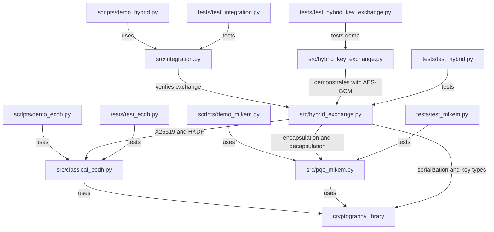
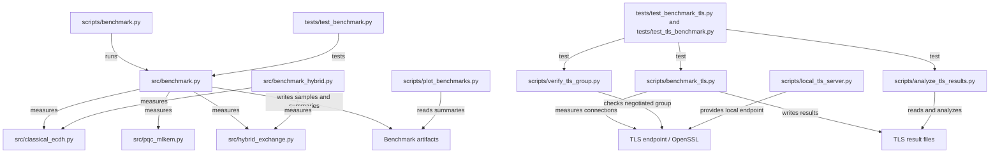
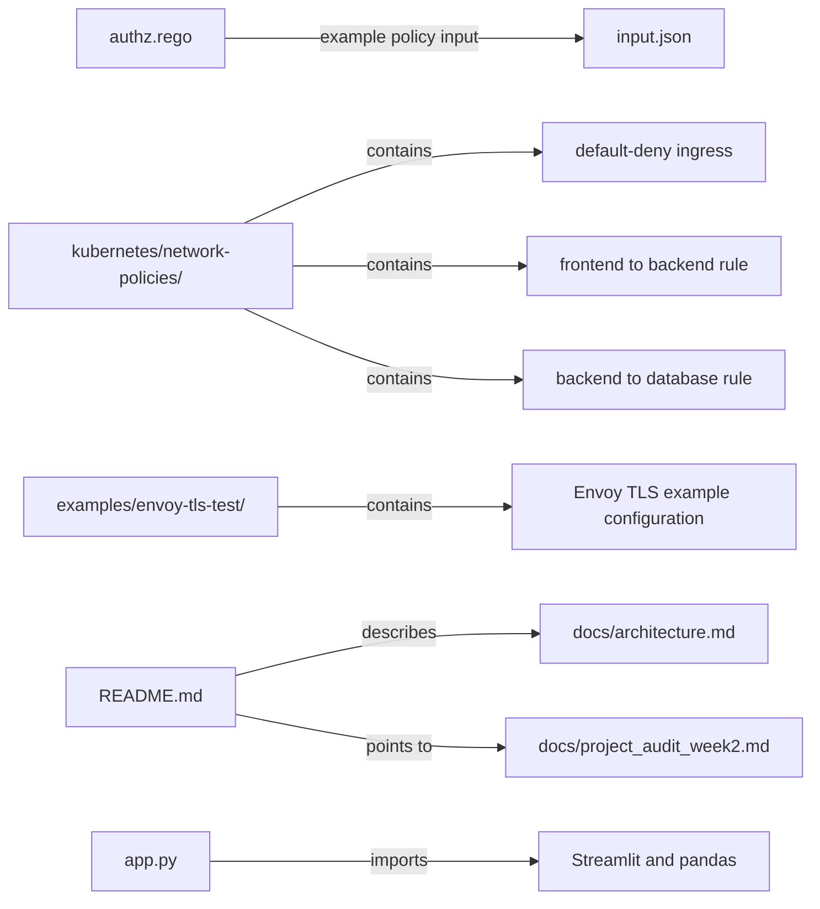

# Codebase knowledge graph

This is a manually assembled, file-level map of the local workspace, based on
source imports and project documentation on 31 October 2026. Arrows describe the
labelled relationship; they do not imply a deployed service connection. It is
not a Graphify index and does not automatically update as files change.

## Key establishment and demos

The hybrid exchange combines the X25519 and ML-KEM secrets using a
transcript-bound HKDF derivation. The integration interface reports public
metadata and validates agreement. This in-memory demonstration is
unauthenticated and is not a production TLS or mTLS implementation. See
[architecture](architecture.md) and [security limitations](security_limitations.md).

## Benchmarking and measurement

The in-process cryptographic benchmark and the TLS measurement are separate
experiments. The documented OpenSSL loopback study measures process-inclusive
duration, not isolated handshake latency. See the [current audit](project_audit_week2.md)
and [benchmarking guide](week2_benchmarking_guide.md).

## Policies, deployment examples, and documentation

The policy files and deployment configurations are examples or supporting
artifacts; their presence does not establish that the hybrid prototype is
integrated with or deployed to OPA, Envoy, or Kubernetes. Consult each file and
the project documentation for its current scope.
