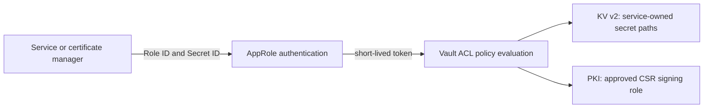

# Vault application authentication and policies

On 5 November 2026, the real local Vault 2.2.1 server was configured with AppRole at `approle/` and the policies in `vault/policies/`. AppRole is a machine authentication method: a Role ID identifies a role, and a Secret ID acts like a password. Vault exchanges both for a token; a token's ACL policies determine which API operations it can perform. TTL limits token lifetime. The configured roles are `service-a`, `service-b`, and `certificate-manager`.

Each role uses a renewable **service token** with a 10-minute TTL and 15-minute maximum; its Secret ID expires after 10 minutes or one login, whichever occurs first. Login and token use are restricted to `127.0.0.1/32`. No default policy is attached. Service tokens were selected so revocation could be demonstrated; batch tokens are an alternative but are non-renewable and have different revocation properties. Use separate secure channels for Role ID and a short-lived, response-wrapped Secret ID. Never commit or paste a Secret ID or token into chat or command history.

Policies grant API capabilities such as `create`, `read`, `update`, `delete`, `list`, and `sudo`. These policies grant only:

| Identity | Allowed | Examples denied |
|---|---|---|
| Service A | `read` on `secret/data/application/service-a/*` | Service B, infrastructure, administration, writes |
| Service B | `read` on `secret/data/application/service-b/*` | Service A, infrastructure, administration, writes |
| Certificate manager | `update` on `pki/sign/service-a-role`, `read` on `pki/cert/ca` | PKI role changes, application secrets, administration, revocation |

Each also has `update` on `sys/capabilities-self` to inspect its own effective permissions. No metadata listing is granted. Vault PKI CA/CRL information may also be publicly readable from an unsealed listener; the API itself is bound to this computer's loopback interface. No monitoring policy or role was created because a concrete monitoring requirement was not established. Certificate revocation remains an administrator responsibility, separate from the certificate-manager identity.

Actual real-server tests used AppRole-issued tokens, not the root token, for the following application requests:

| Test | Expected | Actual |
|---|---|---|
| A reads its database and API configuration | Allow | HTTP 200, pass |
| A reads B, infrastructure, or administrative paths | Deny | HTTP 403, pass |
| A modifies its own secret | Deny | HTTP 403, pass |
| B reads its database and API configuration | Allow | HTTP 200, pass |
| B reads A, infrastructure, or administrative paths | Deny | HTTP 403, pass |
| B modifies its own secret | Deny | HTTP 403, pass |
| Certificate manager signs approved CSR | Allow | HTTP 200; CA signature checked, pass |
| Certificate manager changes a PKI role | Deny | HTTP 403, pass |
| Certificate manager reads A's secret or administrative paths | Deny | HTTP 403, pass |
| Invalid AppRole credentials | Deny | Rejected, pass |
| Missing, invalid, or revoked token reads a secret | Deny | HTTP 403, pass |
| Effective capabilities checked for intended paths | Match | Pass |

An expired token was not independently tested. The access script created one-use Secret IDs and short-lived tokens in process memory, without saving or printing them; one test token was explicitly revoked. It checked role settings and loaded policy content. The remaining test tokens expire under their configured TTL. An invalid authentication failure is distinct from a network error. These are results for this local server and configuration, not proof of production isolation.

The completed phase was run as `python scripts/vault_part2_setup.py auth` in a private PowerShell window with an administrator token at a hidden prompt. It refuses to overwrite an existing AppRole mount or named policies and must not be rerun on the current server. For subsequent operations, use the separate application identity and avoid administrator tokens. See [Member 4 handover](vault_member4_handover.md) and HashiCorp's [AppRole documentation](https://developer.hashicorp.com/vault/docs/auth/approle).
