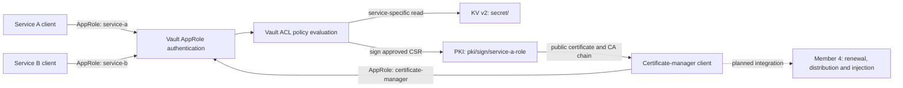

# Vault integration architecture

The diagrams depict the configured local interfaces and planned downstream integration. Member 4's actual application is not present in this workspace, and the downstream flow has not been demonstrated. The certificate manager cannot read Service A's KV secrets under the existing policy; those reads use Service A's separate identity. Vault's listener is localhost-only HTTP and is suitable only for a local demonstration. PKI uses a single online ECDSA P-256 root CA, not a production offline-root hierarchy.
