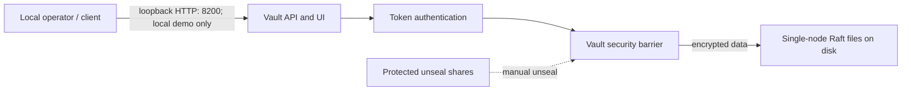

# Week 3, Part 1: Vault deployment and configuration

**Status, 4 November 2026: initialized, restarted and verified.** Vault 2.2.1 runs as a native Windows process with Raft storage and a loopback-only HTTP listener. Before initialization, `vault status` reported `Initialized: false`, `Sealed: true`, `Storage Type: raft`; health returned HTTP 501. The operator initialized the server privately and confirmed that all shares and the root token were saved. `vault status` then reported initialized, unsealed, three shares, threshold two, active Raft, and version 2.2.1. The verifier reported health HTTP 200 and HTTP 403 for both unauthenticated and invalid-token protected requests. The operator reported `PASS token accepted: HTTP 200` in a private terminal; the token was not shared here. After a restart, Vault reported initialized and sealed, with the same three-share/two-share threshold. The operator unsealed it again and reported another successful private token check; subsequent status and health checks confirmed it was unsealed and active.

The host reports Windows build 26300, x64, PowerShell 7.6.5, 15.64 GiB RAM and about 69.4 GiB free on G:. Docker and Compose are unavailable, and WSL reports it is not installed. This folder has no Git metadata, so tracked-file status cannot be checked. Windows `VaultSvc` is a separate system service hosted by `lsass.exe`, not the HashiCorp server.

The first attempts failed with DNS/access errors and a download timeout in the restricted execution environment. A permitted network check resolved `releases.hashicorp.com`; HTTPS reached the official host, and direct downloads succeeded. WinHTTP reported direct access; there was insufficient evidence to attribute the earlier failure to a machine firewall. `winget` was present as an app alias but could not start in the restricted environment. Windows services and networking were inspected with the permitted access needed for those checks.

## Installation and actual evidence

The official [Vault 2.2.1 release](https://releases.hashicorp.com/vault/2.2.1/) Windows AMD64 archive was downloaded into ignored `.tmp/`. Its SHA-256 was `ec0544b354adf70e11db5247b9fa5e7046f70bf0c654944e0095780b5f056342`, matching the published checksum. GPG verified the checksum signature with HashiCorp's key; the primary fingerprint `C874 011F 0AB4 0511 0D02 1055 3436 5D94 72D7 468F` matched HashiCorp's [published verification guidance](https://developer.hashicorp.com/well-architected-framework/verify-hashicorp-binary). GPG did not have an independently certified trust path; the fingerprint comparison was performed separately. `vault/bin/vault.exe` is AMD64 (PE machine `0x8664`), and `./vault/bin/vault.exe version` reported `Vault v2.2.1`, built 2026-10-22. No system PATH change was made.

From the project root, the actual startup command was `./vault/bin/vault.exe server -config=vault/config/vault.hcl`, launched as a hidden process with stdout and stderr redirected to ignored `.tmp/` logs. Startup reported Raft storage and listener `127.0.0.1:8200`, with TLS disabled. `Get-NetTCPConnection` confirmed the API port was bound to loopback. `vault status` returned exit 2, expected for a sealed server. `python scripts/verify_vault.py` reached the real server and reported HTTP 501, initialization false, sealed true, version 2.2.1, Raft, and authentication blocked. This real-server result is distinct from the earlier successful mock-server test. The initial data-directory ACL was restricted to the current user, SYSTEM and administrators; administrators can still access the machine and directory.

For the restart test, Ctrl+C was sent to the dedicated Vault console. Vault logged sealing and shutdown; during teardown it also logged `unlocking HA lock failed: cannot find peer` and `Raft RPC layer closed`, so shutdown was not completely error-free. The first restart failed with `open vault\data\vault.db: Access is denied`: the earlier ACL change had left the files without usable access entries. File ACLs were corrected to grant the current user, SYSTEM and administrators access; no data was deleted. The subsequent restart succeeded and `vault status` showed initialized, sealed, three shares and threshold two. The verifier saw health HTTP 503, the expected sealed response, and blocked authentication until unsealing. Vault emitted `raft FSM db file has wider permissions than needed: needed=-rw------- existing=-rw-rw-rw-`; Windows ACLs were restricted as described, but the warning's cause and its implications have not been independently resolved.

After the operator entered two shares privately, `./vault/bin/vault.exe status` reported initialized true, sealed false, storage raft and HA mode active. `python scripts/verify_vault.py` reported HTTP 200, initialized true, unsealed, and HTTP 403 for unauthenticated and invalid-token access. The operator separately reported that `python scripts/verify_vault.py --token` returned `PASS token accepted: HTTP 200` after the restart. The token was entered privately and this authenticated result is operator-reported. The same Vault cluster ID appeared before and after restart, providing additional evidence that the existing state was reused. No secret engine data was created for this test. An incorrect unseal share was not tested.

## 1–3. Introduction, Zero Trust, and architecture

Vault is a server that authenticates callers and mediates access to sensitive material through an API. In a Zero-Trust design, workloads must prove identity and receive only the access they need; the network location alone is insufficient. Vault is one component of such a system and does not itself provide the project's post-quantum transport or microsegmentation.

The **server** handles requests, identity, authorization and encryption. The **storage backend** persists encrypted Vault state; a process restart must not delete it. Integrated Storage uses Raft and needs no separate database. A single node is suitable for learning but has no fault tolerance. The configured directory is `vault/data/` under this project, excluded from Git. Back up the data and recovery material separately; losing either can make the instance unusable.

A **listener** accepts API requests. The listener address determines where a process accepts connections; `api_addr` is the address Vault advertises. Port 8200 is the API port. This configuration binds to IPv4 loopback only and uses HTTP for a local learning demonstration. HTTP provides no transport encryption or peer validation; local processes and privileged users may observe traffic. A TLS certificate binds a server identity to a public key, and HTTPS clients must validate the certificate chain and hostname. Before broader exposure, configure a trusted CA, matching certificate and private key, enable TLS, and use reachable addresses and appropriate network restrictions. Do not turn off client certificate verification to make a connection work.

**Initialization** creates encryption key material, Shamir unseal shares, and the initial root token for a new storage backend. It happens once per new cluster; never initialize an already initialized backend again. With three shares and a threshold of two, any two different shares unlock the barrier. Protect and back up shares separately. A root token grants extremely broad authority and needs separate protection.

**Sealed** means Vault cannot use the key needed to access protected data. With the default Shamir seal, Vault starts sealed after initialization and after restart; operators submit enough shares to unseal it. **Auto-unseal** instead depends on an external seal provider; it is not configured here. Losing required shares can mean losing access to the stored state.

**Authentication** establishes a caller's identity. Tokens are one built-in authentication mechanism; the initial root token is for initial administration, not routine application access. Applications should later use a suitable dedicated authentication method and least-privilege policies. Those are Part 2, alongside secrets engines and certificate issuance.

## 4–7. Method, prerequisites, and configuration

The preferred Docker Compose method cannot run without Docker. The installed native Windows binary avoids changing other team configurations. Obtain the pinned release from [HashiCorp releases](https://releases.hashicorp.com/vault/2.2.1/) and verify the published signed checksum against the downloaded archive before execution. The verified version **2.2.1** is in ignored `vault/bin/`. A full disk, unavailable port, lack of permissions, or absence of the binary blocks startup. Do not use Vault dev mode.

`vault/config/vault.hcl` configures `ui` for the local UI; `disable_mlock` as recommended for Raft (sensitive memory may be paged to disk, so protect swap); `api_addr` for the advertised API address; and `cluster_addr` for internal Raft communication. The `storage "raft"` block uses relative path `vault/data` and a stable `node_id`. The TCP listener binds `127.0.0.1:8200`, and its cluster listener binds `127.0.0.1:8201`; `tls_disable` makes this local-only HTTP. The `https` cluster address is for Vault's internal cluster transport, not the HTTP API. Review [Raft configuration](https://developer.hashicorp.com/vault/docs/configuration/storage/raft), [listener configuration](https://developer.hashicorp.com/vault/docs/configuration/listener/tcp), and [hardening](https://developer.hashicorp.com/vault/docs/concepts/production-hardening).

From a PowerShell session at the project root, start `./vault/bin/vault.exe server -config=vault/config/vault.hcl` in a dedicated terminal if the server is not already running. Leave that terminal open and inspect its startup output for errors. The data directory already exists; keep its Windows permissions restricted. No automatic restart behavior or service has been implemented or tested. Restart manually with the same command, never deleting `vault/data`.

## 8–12. Initialization, unsealing, authentication, and verification

Set `$env:VAULT_ADDR = 'http://127.0.0.1:8200'` in a second PowerShell session. Run `./vault/bin/vault.exe status` and inspect `Initialized`. A status exit code of 2 can mean sealed; it is not necessarily a startup failure. If initialized, **do not initialize again**; locate the existing recovery material. If uninitialized, run `./vault/bin/vault.exe operator init -key-shares=3 -key-threshold=2` once in a private interactive terminal. This prints sensitive shares and the root token to the screen. Disable terminal recording/transcription first and protect the display; immediately transfer the values into a trusted password manager or other encrypted offline storage. Keep shares separate and ensure authorized recovery custodians can retrieve the threshold. Never paste the output into chat, source files, logs, screenshots, or shell history. If the result is lost, do not reinitialize the existing data; recovery depends on saved material.

After initialization, run `./vault/bin/vault.exe operator unseal` twice, entering a different share at each hidden prompt. Do not put shares in command arguments. Then run `./vault/bin/vault.exe status` and confirm initialized and unsealed. Manual unseal is required again after restart. An invalid key should be rejected; do not use actual shares in an invalid-key test.

To test the administrator token without writing a Vault CLI token helper file, run `python scripts/verify_vault.py --token` and enter the token at the hidden prompt. The script requests `auth/token/lookup-self`, does not print the token, and separately checks unauthenticated and deliberately invalid-token requests. It does not initialize, unseal, or change Vault. Omit `--token` to skip the authenticated check. For an HTTPS deployment, use `--addr https://HOST:8200 --ca-cert PATH_TO_CA`; certificate and hostname verification remain enabled. The verifier returns a failure for an unreachable endpoint or a sealed/uninitialized server, and labels credential-dependent checks BLOCKED. A successful health response is not proof of persistence or network isolation.

## 13–14. Verification and restart

Verify the Vault process, review server output for errors, and run the verifier. Check version, initialized and sealed status, and reported storage type. The UI is configured at `http://127.0.0.1:8200/ui/` on the local machine; the API listener was verified on loopback, but the UI and other network paths were not tested separately. For persistence, record non-sensitive status, stop and restart the server with the same config and data directory, confirm it is still initialized and sealed, manually unseal with two shares, and confirm authenticated access again. Do not remove the data directory. If using a real service or container later, verify its restart behavior separately.

## 15–17. Security, troubleshooting, limitations

This is a single-node local demonstration, not production ready. It has no TLS, auto-unseal, redundancy, backup automation, service manager, audit-device setup, or workload identity configuration. Windows account access, process memory, disk, backups, and terminal output need protection. `disable_mlock` increases risk of secrets reaching swap. If startup fails, inspect the error and verify binary integrity, working directory, data permissions, port conflicts, and config syntax. If the verifier reports connection failure, check the process, address and firewall; if sealed, use the existing shares. Do not delete state to solve errors.

## 18. Part 2

For Part 2, configure KV and PKI secrets engines, application authentication, least-privilege policies, and authorized/unauthorized access tests. None has been configured by this work.

Primary references: [Vault configuration](https://developer.hashicorp.com/vault/docs/configuration), [initialization and unsealing](https://developer.hashicorp.com/vault/tutorials/get-started/setup), [seal concepts](https://developer.hashicorp.com/vault/docs/concepts/seal), and [Vault health API](https://developer.hashicorp.com/vault/api-docs/system/health).
