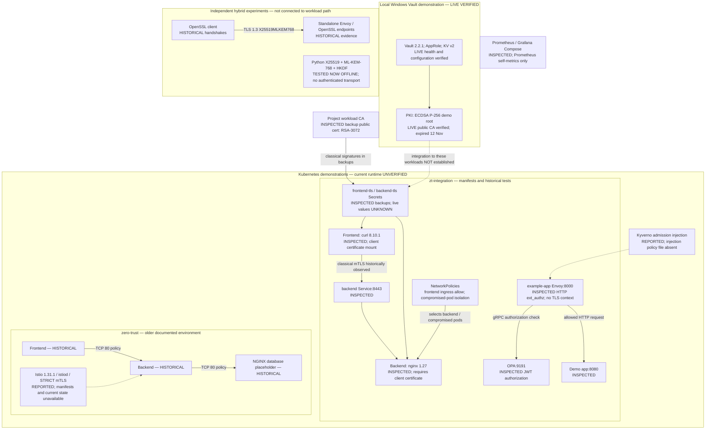

# Week 4, Person 3 — Day 1 architecture assessment

**Project:** Post-Quantum Zero-Trust Microsegmentation Mesh

**Programme:** Certification Program in Agentic Systems and Design, iHUB Divyasampark, IIT Roorkee

**Assessment date:** 23 November 2026 (Asia/Calcutta)

**Scope:** Architecture assessment and cryptographic inventory only. Day 2 strategy and Day 3 roadmap are not completed by this document.

## 1. Assessment outcome and evidence boundaries

The project has a classical Kubernetes security demonstration, independently demonstrated hybrid TLS, an educational Python hybrid key-establishment implementation, and separate Vault certificate-management work. **The available evidence does not establish an integrated post-quantum Kubernetes service mesh.** The recorded frontend-to-backend workload connection uses TLS 1.3, X25519 and RSA certificates. Hybrid key establishment and post-quantum certificate signatures are separate capabilities.

The assessment inspected the local project at `G:\internship\-Post-Quantum-Zero-Trust-Micro-segmentation-Mesh-main`, synchronized earlier to upstream `main` commit `f307cacb5fc0cc8f9577d42f7193c505fb578be4` (17 November 2026). The project root itself has no `.git` history. A baseline inventory covered 297 project files, excluding temporary checkouts/caches, local Vault binaries, persistent Vault data and recovery material. The review covered manifest/configuration files, source and tests, documentation including extracted PDF reports, certificate public metadata, benchmark CSVs and the two HNDL packet captures. It is not a full source-code security audit or software-composition scan.

Evidence labels used throughout:

| Label | Meaning |
|---|---|
| **INSPECTED** | Source, configuration or public certificate inspected on the assessment date; deployment is not implied. |
| **TESTED NOW — OFFLINE** | A local test or saved-artifact check actually executed during this assessment. |
| **LIVE VERIFIED** | A current API check or operator-executed authenticated audit, with sanitized results retained. |
| **HISTORICAL EVIDENCE** | Saved measurement/log or teammate report of a previous test; not a current health check. |
| **VENDOR DOCUMENTED** | Official documentation describes support, but this project has not tested that capability. |
| **UNKNOWN / UNAVAILABLE** | Insufficient evidence, inaccessible runtime or missing artifacts. |
| **PROPOSED** | Future work; not implemented by this assessment. |

Initial read-only checks are recorded in [inspection.json](../evidence/week4-person3-day1/inspection.json). `kubectl`, Docker, Helm and tshark were not discoverable on the session PATH. No Kubernetes API inventory was obtained, so cluster existence, current readiness and current policy enforcement remain **UNKNOWN — runtime verification required**. This does not establish that a teammate's cluster is down. OpenSSL and Vault binaries were found at explicit local paths: OpenSSL 4.1.0 and Vault 2.2.1. Initial local Vault requests failed; a subsequent check with the required local connection access confirmed the server was stopped. At the user's request it was started with its existing configuration/data and unsealed privately by the operator. The [live verification addendum](../evidence/week4-person3-day1/vault-live/README.md) now confirms healthy, unsealed Vault, authenticated configuration and an expired current CA. The initial inspection record is retained as historical evidence of the earlier attempt.

### Principal findings

1. Kubernetes workload hybrid mTLS is not established. The 13 November report records backend OpenSSL 3.0.16 rejecting `X25519MLKEM768`; the frontend image had no OpenSSL CLI. Absence of that executable alone does not determine curl's linked TLS capabilities.
2. RSA workload certificates and an ECDSA P-256 local Vault CA remain classical. No deployed ML-DSA or SLH-DSA certificate is evidenced.
3. OPA/Envoy authorization and NGINX workload mTLS are separate configured paths. The manifests do not prove every mTLS request also passes OPA.
4. The checked-in Secret backup YAMLs contain `tls.key` fields. These are sensitive artifacts; values were not decoded or reproduced. This is an immediate credential-hygiene finding, separate from quantum risk.
5. Historical records disagree on deployment scope and certificate provenance. They require reconciliation before a new live demonstration.

## 2. Existing architecture overview and diagram

The strongest reproducible configuration is the `zt-integration` demonstration. A curl client mounts a client certificate and calls an NGINX backend through a Kubernetes Service on TCP 8443. NGINX validates client certificates against its mounted CA. A NetworkPolicy allows backend ingress from frontend-labelled pods. Separately, `example-app` has Envoy and OPA sidecars: Envoy sends authorization checks to local OPA before forwarding HTTP to the application.

Older `zero-trust` records describe frontend → backend → database traffic on port 80, with the database actually an NGINX placeholder. They also report an Istio installation. They are not interchangeable with `zt-integration`. Local Vault AppRole service names `service-a` and `service-b` are logical test identities, not proven aliases for either namespace's workloads. Python “Service A/B” are simulated in-process participants.

Solid arrows below denote paths supported by configuration or saved evidence, **not currently verified live connections**. Dashed arrows denote reported-only relationships or missing integration. Node labels state their evidence level.

The [standalone Mermaid source](week4_architecture.mmd) contains the same diagram. There is no verified edge connecting the Python prototype or the standalone hybrid listener to Kubernetes workloads, and no assumed common CA across the separate environments.

## 3. Kubernetes component inventory

| Scope / resource | Repository evidence | Assessment |
|---|---|---|
| `zt-integration` namespace | Namespace fields in [workload-deployments.yaml](../workload-deployments.yaml), [workload-mtls.yaml](../workload-mtls.yaml), [OPA integration](../opa-envoy-integration.yaml) | Referenced by manifests; no standalone Namespace manifest found. Historically reported operational. |
| `backend` Deployment | `nginx:1.27`, one replica, port 8443; ConfigMap `backend-nginx-config`; Secret `backend-tls` | NGINX serves a fixed demonstration response, not a business backend. No Envoy sidecar in this manifest. |
| `frontend` Deployment | `curlimages/curl:8.10.1`, one replica, `sleep infinity`; Secret `frontend-tls` mounted at `/etc/mtls` | Client/test workload; no configured listening server. |
| `backend`, `frontend` Services | Both port/targetPort 8443, app selectors; Service type omitted | ClusterIP by Kubernetes default. Backend has a configured listener. Frontend Service has no corresponding listener in its Deployment. |
| `example-app` Deployment | `openpolicyagent/demo-test-server:v1`, `envoyproxy/envoy:v1.33-latest`, `openpolicyagent/opa:latest-envoy`; `proxy_init:v8` init container | Explicit three-container pod. Init container requests NET_ADMIN and redirects traffic to Envoy 8000, excluding OPA health 8282. This is distinct from automatic injection. |
| OPA/Envoy ConfigMaps | `proxy-config`, `opa-envoy-config`, `opa-policy` | Defined in integration manifest; no separate example-app Service or external gateway manifest found. |
| Workload TLS Secrets | [frontend backup](../frontend-tls-backup.yaml), [backend backup](../backend-tls-backup.yaml) | Saved Secret objects, not current live Secret contents. Sensitive private-key fields are present. |
| Backend ingress policy | [mtls-network-policy.yaml](../mtls-network-policy.yaml) | Selects `app=backend`; allows same-namespace `app=frontend` on TCP 8443. Not a namespace-wide ingress or egress default deny. |
| Compromised-pod policy | [compromised-isolation.yaml](../compromised-isolation.yaml), [invocation script](../isolate-compromised-workload.ps1) | Selects `security-status=compromised`, both directions, no allow rules; script manually applies it when labelled pods exist. No continuous alert integration. |
| `zero-trust` network policies | [default deny](../kubernetes/network-policies/default-deny-ingress.yaml), [frontend→backend](../kubernetes/network-policies/allow-frontend-to-backend.yaml), [backend→database](../kubernetes/network-policies/allow-backend-to-database.yaml) | Namespace-wide ingress isolation plus selected TCP 80 allowances; egress is not isolated by these files. |
| `zero-trust` workloads / Istio | [segmentation report](day-2-network-segmentation.md), [Istio report](day-4-istio-mtls.md) | Historical Minikube/Calico, frontend/backend/NGINX database placeholder and Istio 1.31.1. Current pods, identities and effective TLS unknown; Istio report ends mid-sentence. |
| Kyverno / injected pod | 13 November [integration report](Week4_Zero_Trust_Integration_Security_Validation_Report.pdf), sections 3.1–3.3 | Reports ready `inject-opa-envoy-sidecars` ClusterPolicy and an injected 3/3 pod. Referenced `inject-opa-envoy.yaml` is absent from this checkout; current readiness and exact selectors cannot be reconstructed. |
| Service identities and RBAC | DNS SANs in public certificates; no `serviceAccountName` in reviewed deployments | No dedicated ServiceAccount/RBAC manifests found. Kubernetes defaults are not evidence of least-privilege application identities. Backend CA validation alone does not constrain the client to the frontend SAN. |
| Ingress, gateways, build packaging | Full file inventory | No dedicated Ingress/Gateway manifests, Dockerfiles or Helm charts found in project files. Third-party binaries, image tags and historical remote builds remain dependencies. |

The `.txt` workload copies mirror YAML content but do not establish another deployment. The namespace-less `opa-envoy-quickstart-upstream.yaml` is an alternate quickstart and must not be counted as an additional live app. The root `config` is a kubeconfig referencing local certificate/key files; it was not used to authenticate or assumed to be current.

**Policy limitation:** standard Kubernetes NetworkPolicy allows are additive. An empty ingress/egress rule set does not override an allow from another matching policy. The isolation demonstration is evidence for its tested pod and policy set, not a universal deny override. CNI enforcement and all overlapping policies must be checked. A timeout by itself does not prove the cause. [Kubernetes NetworkPolicy semantics](https://kubernetes.io/docs/concepts/services-networking/network-policies/).

## 4. Envoy and TLS analysis

| Path | Actual configuration / evidence | Boundaries |
|---|---|---|
| NGINX frontend→backend | `listen 8443 ssl`, `ssl_verify_client on`, mounted `tls.crt`, `tls.key`, `ca.crt`. Historical report: TLS 1.3, X25519, `TLS_AES_256_GCM_SHA384`, RSA authentication, HTTP 200; missing certificate rejected with HTTP 400. | `ssl_protocols`, groups and ciphers are not explicitly set in the manifest. Current negotiated parameters: **UNKNOWN — runtime verification required**. No proof this path traverses OPA. |
| OPA demo Envoy | Listener 8000 → local app 8080; gRPC authorization at `127.0.0.1:9191` | Neither downstream nor upstream TLS transport socket is configured. Thus the saved config establishes HTTP authorization, not encrypted or hybrid transport. |
| Standalone Envoy example | [envoy.yaml](../examples/envoy-tls-test/envoy.yaml): 8444, TLS minimum 1.3, `/tmp/pqc-cert.pem` and `/tmp/pqc-key.pem`, direct HTTP 200 response | No upstream service, no client certificate requirement, no OPA and no explicit `ecdh_curves`. A `pqc` filename is not proof of algorithm choice. [Generation script](../examples/envoy-tls-test/generate-certs.sh) creates an RSA-2048 self-signed certificate. |
| Historical Envoy hybrid tests | [Build/handshake record](../evidence/envoy-pqc-build-verification.txt): Envoy `1.41.0-dev`, BoringSSL, build `85aa7f0...`; direct handshake reports X25519MLKEM768 | This build is not the `v1.33-latest` image in the OPA manifest. Embedded binary strings alone are weaker evidence than negotiated-group output. Exact current running build/config unavailable. |
| November 1 remote comparison | [Study scope](../results/week2/envoy-tailscale-20261101/README.md), [hybrid preflight](../evidence/envoy-tailscale-20261101/hybrid.json), forward and reverse CSVs | Saved rows record TLS 1.3, exact groups, certificate checks and no resumption. Server-authenticated TLS only; no client certificate. Endpoint build was team-reported, not independently queried in that measurement. |
| Host hybrid mTLS | 13 November integration PDF, section 4 | Reports successful hybrid client/server authentication and missing-certificate rejection on the host. Named raw positive/negative hybrid log files are absent here. Treat as reported historical evidence, not independently reproduced. |

Official Envoy documentation exposes separate controls for protocol versions, ECDH groups and signature algorithms; defaults depend on the build. A TLS 1.3 cipher suite such as `TLS_AES_256_GCM_SHA384` does not identify the negotiated key-exchange group or certificate signature. [Envoy TLS parameters](https://www.envoyproxy.io/docs/envoy/latest/api-v3/extensions/transport_sockets/tls/v3/common.proto).

**Certificate provenance discrepancy:** the current Envoy test certificate fingerprint is `e83728bd42ee4cb04af2aef84016991e4f2a7484b63699650630c1385d32106b`; the November 1 study notes record `3efd77273aa6f023de9870aefb18947a64d7121d3b2405c87c224b6f42fb293189`. These do not match. Historical successful validation remains a recorded result, but the current certificate file cannot independently reproduce that trust identity without clarification. No certificate was replaced during this assessment.

## 5. OPA authorization analysis

The integration ConfigMap evaluates `envoy/authz/allow`. Envoy's `ext_authz` filter has `failure_mode_allow: false`, a 0.5-second timeout and request-body buffering up to 8192 bytes with partial bodies allowed. OPA exposes the authorization plugin on 9191, local API on 8181 and diagnostic health on 8282. Decision logs go to console.

The Rego policy verifies a JWT using a hardcoded demonstration shared secret, checks `nbf` and `exp`, permits guest/admin GET under `/people*`, and permits constrained admin POST to `/people`. The exact JWT algorithm is not explicitly pinned in this policy: **UNKNOWN — runtime verification required** for the actual accepted algorithm. There are no explicit issuer/audience checks or client-certificate-to-JWT binding in the saved policy. The separate root [authz.rego](../authz.rego) simply permits `input.role == "admin"`; it is not the sidecar policy.

[OPA Deployment Note](OPA%20Deployment%20Note) reports missing/invalid JWT → 403, guest GET → 200, guest POST → 403. The integration PDF reports OPA 1.22.0 at its test time; the mutable image tag does not pin that version. No tests were rerun against live OPA here.

**Policy updates:** the manifest loads `/policy/policy.rego`; no `--watch`, bundle polling configuration or explicit rollout workflow is present. ConfigMap projection updates alone do not prove OPA reloads policy. Hot reload, propagation delay, rollback and behavior during OPA failure remain unverified. OPA controls request authorization; it neither supplies PQC key exchange nor proves client identity without trustworthy input.

## 6. Vault and certificate-management analysis

Three records must remain distinct:

| Environment | Supported conclusion | Unresolved boundary |
|---|---|---|
| Local Windows persistent Vault | [Config](../vault/config/vault.hcl): loopback HTTP 8200, TLS disabled, Raft in `vault/data`, local node. [November 8 tests](vault_integration_tests.md): 49/49 recorded live integration checks. [November 23 verification](../evidence/week4-person3-day1/vault-live/README.md): Vault 2.2.1 healthy/unsealed, KV v2, AppRole, policies and ECDSA P-256 PKI confirmed. | Current CA is expired. Authenticated configuration audit completed through a private operator prompt; the historical issuance/revocation tests were not repeated. |
| Separate Week 3 `cert-demo` integration | [Rotation report](../WEEK3-VAULT-CERTIFICATE-ROTATION.md) reports a development-mode Vault, RSA-2048 leaf, NGINX HTTPS, Secret update and restart. | Different CA/workload from local `service-a.mesh.test`. Report references a rotation script not available as a matching checked-in workflow; no periodic schedule evidenced. |
| `zt-integration` workload experiment | November 13 integration PDF says no Vault deployment in that inspected environment; rotation evidence describes project CA signing and Kubernetes Secret updates. | This does not negate the separate local Vault server. No proven link from its AppRoles/PKI to these workload Secrets. |

Local Vault's historical `secret/` KV v2 mount retained five versions of synthetic service configuration. AppRole identities `service-a`, `service-b`, `certificate-manager` have separate policies. A/B can read only their own data prefixes. The certificate manager can sign through `pki/sign/service-a-role` and read the public CA; it cannot issue through `pki/issue`, administer roles or revoke certificates. Historic role settings: 600-second token/Secret ID TTL, 900-second token maximum, one Secret ID use and loopback IP restrictions. [Access policies](vault_access_policies.md), [KV record](vault_secret_storage.md), [policy files](../vault/policies/).

The PKI uses one online ECDSA P-256 root, a historically recorded 168-hour lifetime, exact name `service-a.mesh.test`, one-hour default and 24-hour maximum leaf TTL. The current role restrictions were confirmed by the November 23 authenticated audit. CSR signing and inclusion of a revoked test serial in a signed CRL were tested historically; client-side revocation enforcement, token renewal/expiry, periodic certificate rotation and workload reload were not. **The current default public CA was retrieved live and is expired: 12 November 2026 at 11:40:42 UTC.** Its signature is ECDSA-with-SHA256; it is the `Local Vault Demonstration CA`, not a PQ signature issuer. No CA was replaced. [Live evidence](../evidence/week4-person3-day1/vault-live/README.md), [historical PKI configuration](vault_pki_configuration.md), [handover](vault_member4_handover.md).

Current official Vault 2.2 release notes document ML-DSA X.509 support; its PKI API documents ML-DSA parameter sets. Classify this as **VENDOR DOCUMENTED, NOT PROJECT-TESTED**, not as “Vault cannot support PQC” or “PQC certificates are deployed.” The configured local EC role is not evidence of ML-DSA issuance or client interoperability. [Vault release notes](https://developer.hashicorp.com/vault/docs/updates/release-notes), [PKI API](https://developer.hashicorp.com/vault/api-docs/secret/pki).

## 7. Cryptographic inventory and classical/PQC status

The [detailed cryptographic inventory](cryptographic_inventory.md) is the authoritative component table, including algorithms, functions, evidence, verification gaps and migration requirements.

| Function | Actual project finding | Status |
|---|---|---|
| Classical key establishment | X25519 in Python and historical Kubernetes TLS | Quantum-vulnerable public-key dependency; current workload negotiation unverified. |
| PQ key establishment | ML-KEM-768 Python API; X25519MLKEM768 in saved TLS handshakes/captures | Tested offline now / evidenced historically; not established for Kubernetes workload mTLS. |
| Authentication and certificate signatures | RSA workload/test certificates; ECDSA P-256 local Vault PKI | Classical. No project ML-DSA or SLH-DSA issuance/verification evidence. |
| Derivation and encryption | HKDF-SHA-256, SHA-256 transcript hashing; AES-256-GCM in Python demos and key rotation | Distinct from asymmetric migration. Python prototype is not a reviewed TLS protocol. |
| Authorization and secrets | Rego/JWT policy, AppRole/token ACLs, KV v2 | Access controls, not PQC algorithms. Exact JWT digest and Vault storage-encryption parameters were not established here. |

ML-KEM establishes shared key material; ML-DSA and SLH-DSA are signature algorithms. Their standards are FIPS 203, 204 and 205 respectively, all published 13 August 2024. None is interchangeable merely because all are called PQC. [FIPS 203](https://csrc.nist.gov/pubs/fips/203/final), [FIPS 204](https://csrc.nist.gov/pubs/fips/204/final), [FIPS 205](https://csrc.nist.gov/pubs/fips/205/final).

### Verification performed today

- 43 existing tests passed for X25519, ML-KEM, hybrid derivation, integration metadata and AES-GCM demonstration. Python 3.13.12; `cryptography` 50.0.2 using OpenSSL 4.0.3, distinct from the installed OpenSSL 4.1.0 executable.
- 16 existing key-rotation tests passed when run from `src` with unittest. Initial combined root pytest collection failed because that test imports `Key_rotation` as a top-level module. The successful invocation and the initial failure are both retained; no source edits were made. These results do not claim the full project suite passed.
- Both November 1 benchmark CSVs contain 200 rows, 100 per group; saved rows report successful TLS 1.3, validated certificates and no session reuse. This checks recorded data, not a new network experiment.
- Public certificate algorithms/validity were parsed without accessing private-key values. Backup workload leaves are RSA-2048 and their CA RSA-3072, signed with SHA-256/RSA. They predate the November 13 rotation and cannot establish current mounted certificates.
- Offline PCAP parsing confirmed the Hello key shares and server-selected TLS version below. No session was decrypted and no new traffic captured.

| Capture | Packets / bytes | Client / server key-share bytes | Group in both Hellos |
|---|---:|---:|---|
| Classical | 14 / 3,617 | 32 / 32 | `0x001d` (X25519) |
| Hybrid | 14 / 5,883 | 1,216 / 1,120 | `0x11ec` (X25519MLKEM768) |

Both ServerHellos select TLS 1.3 (`0x0304`). The group names were checked against the [IANA TLS Supported Groups registry](https://www.iana.org/assignments/tls-parameters#tls-parameters-8): 29 is X25519 and 4588 is X25519MLKEM768. Scope and evidence: [offline tests](../evidence/week4-person3-day1/offline-tests.txt), [PCAP inspection](../evidence/week4-person3-day1/pcap-summary.json), [original HNDL report](../results/week4-hndl/HNDL-ATTACK-SIMULATION-REPORT.md). The original experiment reports certificate trust failures. Captured Hellos do not validate identities or demonstrate quantum decryption.

## 8. Migration gaps and dependencies

| ID | Gap and impact | Evidence / closure requirement |
|---|---|---|
| G1 | Kubernetes workloads still have a classical transport baseline | Exact running curl/NGINX libraries, image digests, both peers' groups and an in-cluster handshake must be verified. Historical backend OpenSSL rejection is a concrete blocker for that tested binary. |
| G2 | Classical certificate trust dependencies | Inventory each CA separately; test certificate profiles, trust-chain validation, both client/server authentication and revocation before considering signature replacement. |
| G3 | Secrets present in versioned backup artifacts | `tls.key` fields exist in both upstream Secret backups. Treat those credentials as exposed; owner must confirm replacement/revocation and review historical distribution. Do not reuse these backups. No key deletion, rotation or history rewrite performed here. |
| G4 | Certificate validity/provenance gaps | Live default Vault CA confirmed expired; loopback benchmark certificate expired 2 November; current Envoy test fingerprint differs from study notes. Reconcile issuer and trust material before rerunning demonstrations. |
| G5 | Authorization not demonstrably bound to workload identity | Demo shared JWT secret, no explicit issuer/audience/algorithm restriction, broad paths and no certificate identity binding. Verify effective authorization on the actual mTLS route and policy-update behavior. |
| G6 | Segmentation and isolation assumptions | Namespace/port mismatches, no general egress policy, additive allowances, manually assigned compromise label. Verify effective policy union, CNI behavior and recovery rather than assuming absolute isolation. |
| G7 | Vault integration and lifecycle discontinuity | Loopback-only plaintext API; AppRole addresses local-only; no proven connection to `zt-integration`. Periodic renewal, distribution and reload need an owned, tested workflow. |
| G8 | Unpinned or unavailable deployment dependencies | Mutable OPA/Envoy/monitoring image tags; missing injection policy and some raw logs; standalone Envoy build differs from deployment tag. Pin/recover provenance before capability claims. |
| G9 | Python algorithm coupling and key lifecycle | Hardcoded X25519/ML-KEM-768 and custom transcript/HKDF prototype; no authenticated network protocol. AES rotation is a separate in-memory manager, not certificate rotation; old keys are discarded after grace period without durable recovery. |
| G10 | Limited observability and performance coverage | Prometheus scrapes only itself; Streamlit uses simulated events. No verified mesh-wide group/signature metrics, CPU/memory cost or load/MTU tests. |
| G11 | Unknown external/control-plane dependencies | Kubernetes API/etcd encryption, actual client identities, external peers, registries, operating-system TLS and VPN encryption are not fully inventoried. Public CA files alone do not establish all control-plane algorithms. |

No service replacement is mandated by this assessment. Legacy endpoints may need upgraded libraries/images or an authenticated proxy boundary, but selecting that design belongs to Day 2. No unsupported-library claim is inferred solely from a product name.

### Performance and network-size interpretation

The two saved remote Envoy studies report mean handshake times of 226.73/245.58 ms and 222.66/286.38 ms (classical/hybrid), with 100 observations per group in each study. They include network round trips and client scheduling over a relayed Tailscale path; the measured build was not re-queried. They do not isolate algorithm cost or predict Kubernetes overhead. [Forward report](../results/week2/envoy-tailscale-20261101/report/report.md), [reverse report](../results/week2/envoy-tailscale-reverse-20261101/report/report.md).

The PCAPs are 2,266 bytes different in total file size; that includes capture/protocol overhead and is not a general per-session bandwidth result. Larger hybrid key shares motivate MTU, segmentation, loss, retransmission and middlebox testing. No fragmentation failure was demonstrated here. Existing in-process crypto benchmarks measure a different workload; older subprocess TLS measurements include process lifetime and must not be compared as handshake-only latency.

## 9. HNDL risk assessment

Harvest Now, Decrypt Later means storing encrypted traffic now for possible future recovery when its public-key key establishment can be broken. Long confidentiality lifetimes can justify action before such a computer exists; no arrival date is assumed. [NIST PQC explanation](https://www.nist.gov/cybersecurity-and-privacy/what-post-quantum-cryptography).

Recorded classical X25519 sessions are the relevant confidentiality exposure under that threat model. Classical certificate signatures are a separate future authentication/forgery dependency. A certificate expiring or a new key being issued does not retroactively protect an already recorded classical session. Hybrid key establishment is intended to add post-quantum protection, subject to the protocol and implementation assumptions; it does not turn RSA certificates into PQ signatures or fix missing trust validation.

No real customer dataset or enterprise retention policy was found. The existing backend response, NGINX placeholder, Vault sample secrets and dashboard events are demonstrations. **Actual business sensitivity and confidentiality lifetimes are UNKNOWN and must be supplied by data owners.** The following ranges are explicit planning assumptions for later enterprise analysis, not facts about this project or legal retention requirements.

| Information / path | Observed data and exposure | Confidentiality lifetime | Provisional assessment |
|---|---|---|---|
| Frontend→backend payloads | Fixed demo response over classical mTLS; future application data unknown | Demo: no evidenced long-term secrecy; hypothetical sensitive records: 5–10 years, owner to confirm | Low evidenced demo impact; high conditional HNDL priority if sensitive long-lived data is introduced. |
| Backend→database | Older NGINX placeholder; not a real database/data inventory | UNKNOWN; hypothetical enterprise records 5–10 years | Do not infer high sensitivity just from the word database. Classify before ranking migration. |
| Vault configuration/secrets | Historical synthetic KV values; live mount and role audit confirmed 10-minute token TTL/15-minute max; secret values not read | Token lifetime is short; secrets' required secrecy may outlive a token. Real values' lifetime UNKNOWN | High operational importance if used for real credentials. Plaintext API and credential exposure are immediate risks distinct from HNDL. |
| CA/workload private keys | Private-key fields in saved Secret backups; multiple separate CAs | Protection required throughout use and any relevant signing/retention period | Immediate exposure remediation takes priority; this is not a speculative quantum attack. |
| Captures and benchmark data | Public demonstration captures, including failed trust validation | No production confidentiality requirement evidenced | Useful experimental evidence; not evidence of protected production data or successful decryption. |
| Monitoring and authorization logs | Prometheus self-metrics, simulated Streamlit data; OPA console decisions configured | UNKNOWN; hypothetical sensitive audit records 1–7 years, owner to confirm | Review claims/body logging and access before introducing real identities. |

Prioritization must jointly consider sensitivity, confidentiality lifetime, untrusted-network exposure, service importance, crypto dependencies and migration complexity. Exposure of a private network path is not assumed equivalent to public internet traffic. NIST's migration project emphasizes discovery and interoperability testing as inputs to prioritization. [NCCoE migration project](https://www.nccoe.nist.gov/applied-cryptography/migration-to-pqc).

## 10. Recommended priorities for Day 2 input

These are assessment priorities, not an implemented migration strategy or a rollout schedule.

| Priority | Component / decision | Reason and dependency |
|---|---|---|
| **P0: readiness** | Secret-backup exposure, recorded CA expiry, trust-file mismatch | Existing security/reproducibility concerns. Workload/PKI owners must establish safe current identities before live demonstrations. |
| **P1: establish baseline** | `zt-integration` frontend/backend and authorization route | Known classical path and historical compatibility blocker. Obtain live image/library/configuration evidence, identify data owners and confirm policy enforcement. |
| **P1: confidentiality candidate** | Any verified long-lived sensitive service crossing an untrusted boundary | Highest conditional HNDL importance; no such production service has been identified yet. Prioritize only after data classification. |
| **P1: trust dependency** | Workload CA, local Vault PKI and issuer ownership | Separate CA identities, local-only controls and lifecycle gaps affect every later migration. Signature capability must be assessed separately from transport. |
| **P2: reproducible capability baseline** | Standalone hybrid endpoint and monitoring | Existing evidence helps feasibility testing; recover exact build/config/trust material and add observability requirements before selecting a pilot. |
| **P2: identity/operations** | OPA, policy updates, image provenance and NetworkPolicy overlap | Preserve Zero-Trust controls through any future cryptographic change. |
| **P3: educational/legacy clarification** | Python prototype, `zero-trust` placeholder workloads, missing Kyverno artifacts | Preserve useful learning components; do not treat the custom Python handshake as a deployable TLS replacement. Confirm which environment remains in scope. |

## 11. Acceptance and handoff

- [x] Project file inventory and relevant historical documentation inspected.
- [x] Kubernetes namespaces, workload paths, Services, policies and missing resources assessed.
- [x] Envoy downstream/upstream TLS and hybrid negotiation evidence reviewed.
- [x] OPA authorization, identity boundaries and update uncertainty documented.
- [x] Vault configuration, PKI/KV/AppRole history and present availability assessed.
- [x] Algorithms separated by purpose in the detailed inventory.
- [x] HNDL risk, data-lifetime unknowns and conditional priorities recorded.
- [x] Migration gaps and interoperability/performance limitations documented.
- [x] Evidence-labelled Mermaid architecture diagram created.
- [x] Day 1 report, supporting checks and preservation verification completed.

**DAY 1 COMPLETE WITH DOCUMENTED LIMITATIONS.** Live Vault verification is now complete for service health, authenticated configuration and public CA inspection; the current CA is expired. Kubernetes runtime verification remains unavailable/unperformed. Day 2 and Day 3 remain pending. The Day 2 handoff must resolve current cluster access/configuration, data classification, credential/CA ownership, image provenance and whether the older `zero-trust` environment is still active. Existing source, policy, certificate and recovery material was preserved. The user-authorized Vault follow-up started the existing server and the operator unsealed it; no initialization, secret-engine changes, policy changes, issuance or certificate replacement was performed. Vault's normal runtime state can change during startup/unsealing.

Official references linked near the relevant claims were checked on 23 November 2026. NIST FIPS documents are standards; Kubernetes, Envoy and Vault pages are implementation documentation; the NCCoE material is migration guidance. Their presence does not certify this deployment or automatically create regulatory obligations for this Indian academic project. Detailed transition deadlines and hybrid-protocol standards status are reserved for Day 2 research.
