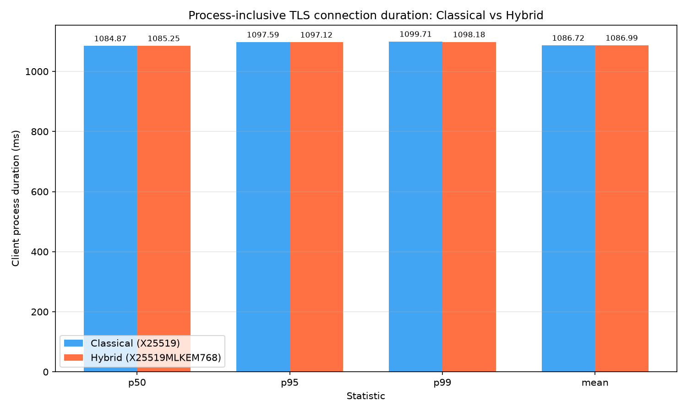
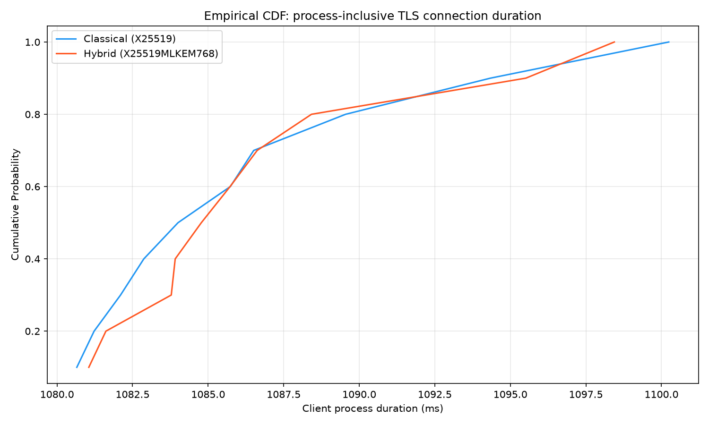
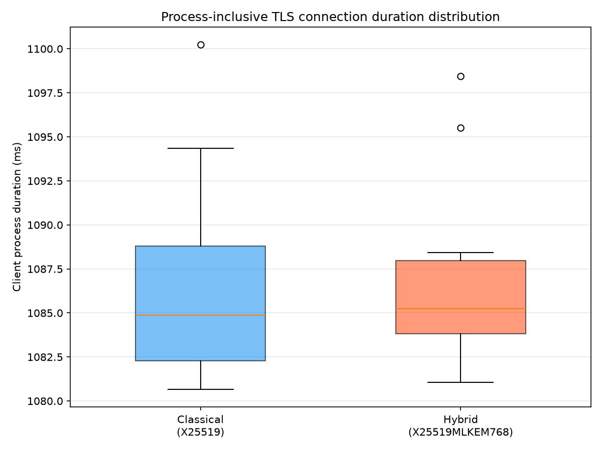

# Week 2 TLS Benchmark — Comparative Analysis Report

Generated: 2026-10-31T07:40:28.211849+00:00

## Executive Summary

The hybrid client process duration had a median (p50) 0.3815 ms higher than the classical duration (+0.04% relative difference). This is not isolated handshake latency.

## Experimental Setup

### Classical Run
- Run ID: 9bc9beb3c469
- Target: 127.0.0.1:18444
- Expected group: X25519
- Python: 3.13.12 (tags/v3.13.12:1cbe481, Feb  3 2026, 18:22:25) [MSC v.1944 64 bit (AMD64)]
- Python OpenSSL backend: OpenSSL 3.0.18 30 Sep 2025
- OpenSSL client: OpenSSL 4.1.0 23 Oct 2026 (Library: OpenSSL 4.1.0 23 Oct 2026)
- OpenSSL server: unknown; supply server provenance separately
- Server configuration: unknown; supply server provenance separately
- Network path: unspecified; document endpoint and network path separately
- OS: Windows 11
- Warmup: 3
- Measured: 10
- Timeout: 10.0s
- Timing: Process-inclusive duration: from immediately before calling verify_tls_group through OpenSSL path resolution, client startup, TCP, TLS, certificate verification, output capture, process exit, and Python parsing. Not isolated TLS handshake latency.
- Ordering: not recorded

### Hybrid Run
- Run ID: 8931556a207e
- Target: 127.0.0.1:18444
- Expected group: X25519MLKEM768
- Python: 3.13.12 (tags/v3.13.12:1cbe481, Feb  3 2026, 18:22:25) [MSC v.1944 64 bit (AMD64)]
- Python OpenSSL backend: OpenSSL 3.0.18 30 Sep 2025
- OpenSSL client: OpenSSL 4.1.0 23 Oct 2026 (Library: OpenSSL 4.1.0 23 Oct 2026)
- OpenSSL server: unknown; supply server provenance separately
- Server configuration: unknown; supply server provenance separately
- Network path: unspecified; document endpoint and network path separately
- OS: Windows 11
- Warmup: 3
- Measured: 10
- Timeout: 10.0s
- Timing: Process-inclusive duration: from immediately before calling verify_tls_group through OpenSSL path resolution, client startup, TCP, TLS, certificate verification, output capture, process exit, and Python parsing. Not isolated TLS handshake latency.
- Ordering: not recorded

## Results

| Metric | Classical (X25519) | Hybrid (X25519MLKEM768) |
| --- | --- | --- |
| Total attempts | 10 | 10 |
| Successful | 10 | 10 |
| Failed | 0 | 0 |
| Success rate | 100.0% | 100.0% |
| p50 process duration (ms) | 1084.8686 | 1085.2501 |
| p95 process duration (ms) | 1097.5871 | 1097.1229 |
| p99 process duration (ms) | 1099.7109 | 1098.1766 |
| Mean process duration (ms) | 1086.7236 | 1086.9856 |
| Std deviation (ms) | 6.3282 | 5.7382 |
| Min latency (ms) | 1080.6553 | 1081.0521 |
| Max latency (ms) | 1100.2418 | 1098.4400 |

## Comparative Analysis

| Percentile | Difference, hybrid minus classical (ms) | Relative difference (%) |
| --- | --- | --- |
| p50 | 0.3815 | 0.0352 |
| p95 | -0.4641 | -0.0423 |
| p99 | -1.5343 | -0.1395 |
| mean | 0.2620 | 0.0241 |

Relative overhead (%) = ((hybrid - classical) / classical) × 100. Positive values indicate hybrid is slower.

## Charts







## Limitations

- Each accepted input row has OpenSSL-reported TLS 1.3, certificate, and named-group evidence.
- Each accepted row records an OpenSSL-observed new session; unknown or resumed sessions are rejected.
- Timing includes client process startup, TCP, TLS, validation, output capture, shutdown and parsing; it is not pure handshake latency.
- Small samples, especially p99 estimates, are sensitive to outliers and ordering effects.
- A process-duration difference cannot be attributed solely to the handshake or generalized to other systems.
- Results apply only to the specific endpoint, hardware, and software versions tested.
- Loopback connections do not measure realistic network conditions.
- No packet capture or handshake-size data was collected.

## Reproduction Instructions

```powershell
python scripts/analyze_tls_results.py --classical-csv <classical/raw.csv> --hybrid-csv <hybrid/raw.csv> --output-dir <new-output-directory>
```
