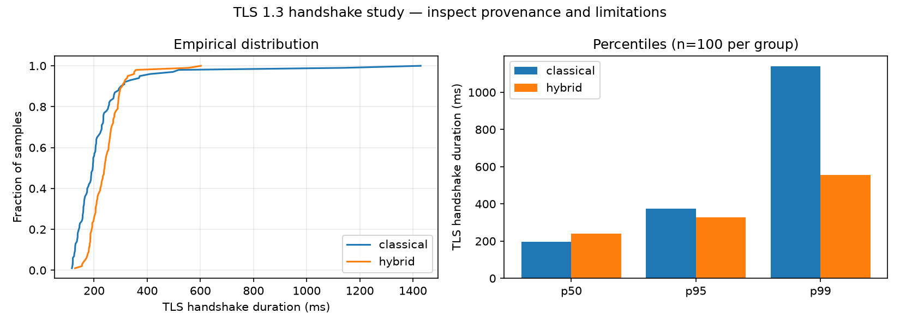

# TLS handshake study

Run ID: eee53cf8b766

Timing starts after TCP connects and ends when the TLS handshake completes; certificate validation is included.
The timer includes Python scheduling overhead. See metadata and accompanying study notes for server provenance.

| Metric | Classical | Hybrid |
| --- | ---: | ---: |
| Count | 100.0000 | 100.0000 |
| p50 ms | 195.1531 | 239.5754 |
| p95 ms | 373.7393 | 327.7337 |
| p99 ms | 1139.7523 | 555.8999 |
| Mean ms | 226.7296 | 245.5834 |
| Sample stddev ms | 170.2911 | 68.1060 |
| Min ms | 116.6397 | 128.1917 |
| Max ms | 1429.3020 | 602.1295 |

All rows were verified as TLS 1.3, expected group, certificate valid, and not resumed.
Percentiles use linear interpolation; no outliers removed.

