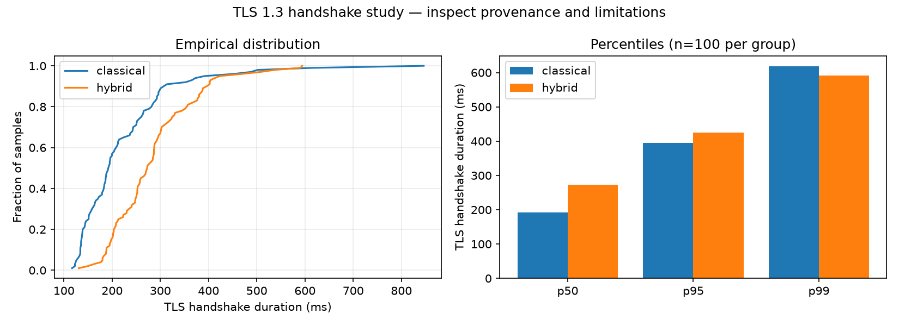

# TLS handshake study

Run ID: cf7eb0364d42

Timing starts after TCP connects and ends when the TLS handshake completes; certificate validation is included.
The timer includes Python scheduling overhead. See metadata and accompanying study notes for server provenance.

| Metric | Classical | Hybrid |
| --- | ---: | ---: |
| Count | 100.0000 | 100.0000 |
| p50 ms | 192.6288 | 272.8049 |
| p95 ms | 394.6559 | 425.5683 |
| p99 ms | 618.2272 | 590.8987 |
| Mean ms | 222.6644 | 286.3829 |
| Sample stddev ms | 108.8507 | 89.6607 |
| Min ms | 116.8403 | 130.6195 |
| Max ms | 846.3289 | 594.0028 |

All rows were verified as TLS 1.3, expected group, certificate valid, and not resumed.
Percentiles use linear interpolation; no outliers removed.

