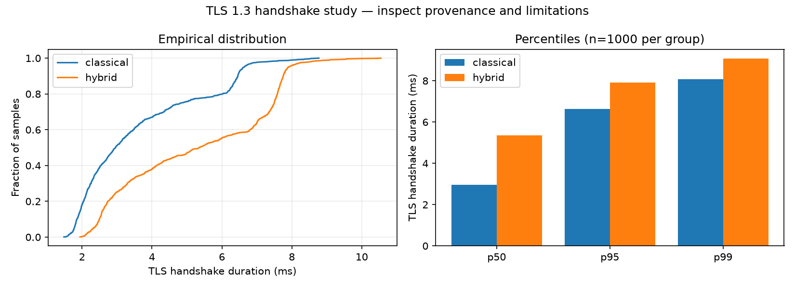

# TLS handshake study

Run ID: ad33851816ee

Timing starts after TCP connects and ends when the TLS handshake completes; certificate validation is included.
The timer includes Python scheduling overhead. See metadata and accompanying study notes for server provenance.

| Metric | Classical | Hybrid |
| --- | ---: | ---: |
| Count | 1000.0000 | 1000.0000 |
| p50 ms | 2.9585 | 5.3504 |
| p95 ms | 6.6341 | 7.9067 |
| p99 ms | 8.0773 | 9.0761 |
| Mean ms | 3.6198 | 5.2794 |
| Sample stddev ms | 1.7801 | 2.1833 |
| Min ms | 1.4838 | 1.9441 |
| Max ms | 8.7727 | 10.5479 |

All rows were verified as TLS 1.3, expected group, certificate valid, and not resumed.
Percentiles use linear interpolation; no outliers removed.

