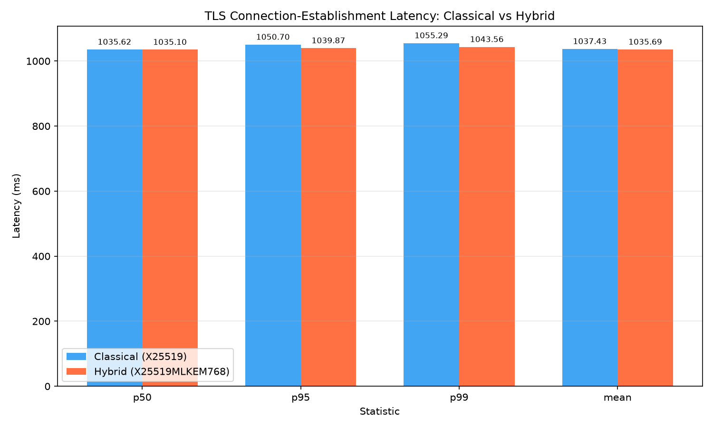
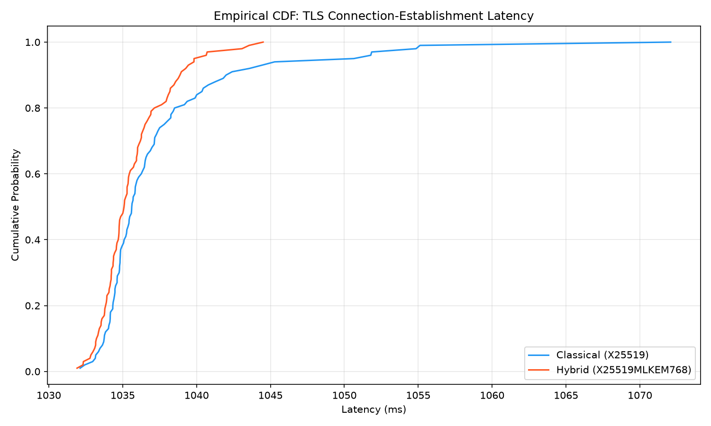
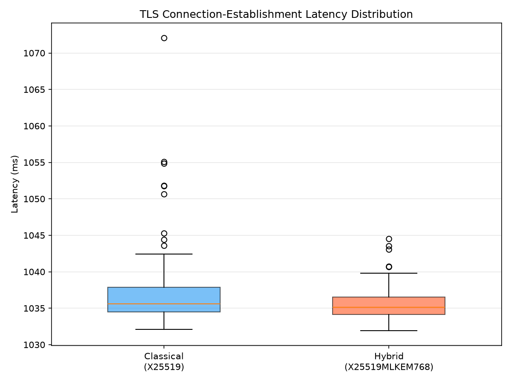

# Week 2 TLS Benchmark — Comparative Analysis Report

Generated: 2026-10-28T17:41:02.889264+00:00

## Executive Summary

The hybrid client process duration had a median (p50) 0.5204 ms lower than the classical duration (-0.05% relative difference). This is not isolated handshake latency.

## Experimental Setup

### Classical Run
- Run ID: paired-classical-combined
- Target: 127.0.0.1:19534
- Expected group: X25519
- Python: 3.13.12 (tags/v3.13.12:1cbe481, Feb  3 2026, 18:22:25) [MSC v.1944 64 bit (AMD64)]
- Python OpenSSL backend: OpenSSL 3.0.18 30 Sep 2025
- OpenSSL client: OpenSSL 4.1.0 23 Oct 2026 (Library: OpenSSL 4.1.0 23 Oct 2026)
- OpenSSL server: OpenSSL 4.1.0 23 Oct 2026 (Library: OpenSSL 4.1.0 23 Oct 2026)
- Server configuration: OpenSSL s_server -tls1_3 -groups X25519:X25519MLKEM768 -www; no client authentication or authorization
- Network path: IPv4 loopback 127.0.0.1:19534
- OS: Windows 11
- Warmup: 10
- Measured: 100
- Timeout: 5s
- Timing: Connection-establishment latency: from immediately before openssl s_client starts through direct TLS 1.3 group and certificate verification and process exit. Includes client process startup, TCP setup, and shutdown.
- Ordering: hybrid, classical, classical, hybrid; two blocks of 50 attempts per mode

### Hybrid Run
- Run ID: paired-hybrid-combined
- Target: 127.0.0.1:19534
- Expected group: X25519MLKEM768
- Python: 3.13.12 (tags/v3.13.12:1cbe481, Feb  3 2026, 18:22:25) [MSC v.1944 64 bit (AMD64)]
- Python OpenSSL backend: OpenSSL 3.0.18 30 Sep 2025
- OpenSSL client: OpenSSL 4.1.0 23 Oct 2026 (Library: OpenSSL 4.1.0 23 Oct 2026)
- OpenSSL server: OpenSSL 4.1.0 23 Oct 2026 (Library: OpenSSL 4.1.0 23 Oct 2026)
- Server configuration: OpenSSL s_server -tls1_3 -groups X25519:X25519MLKEM768 -www; no client authentication or authorization
- Network path: IPv4 loopback 127.0.0.1:19534
- OS: Windows 11
- Warmup: 10
- Measured: 100
- Timeout: 5s
- Timing: Connection-establishment latency: from immediately before openssl s_client starts through direct TLS 1.3 group and certificate verification and process exit. Includes client process startup, TCP setup, and shutdown.
- Ordering: hybrid, classical, classical, hybrid; two blocks of 50 attempts per mode

## Results

| Metric | Classical (X25519) | Hybrid (X25519MLKEM768) |
| --- | --- | --- |
| Total attempts | 100 | 100 |
| Successful | 100 | 100 |
| Failed | 0 | 0 |
| Success rate | 100.0% | 100.0% |
| p50 process duration (ms) | 1035.6246 | 1035.1042 |
| p95 process duration (ms) | 1050.6977 | 1039.8693 |
| p99 process duration (ms) | 1055.2880 | 1043.5635 |
| Mean process duration (ms) | 1037.4300 | 1035.6891 |
| Std deviation (ms) | 5.6855 | 2.4090 |
| Min latency (ms) | 1032.1200 | 1031.9120 |
| Max latency (ms) | 1072.0788 | 1044.5021 |

## Comparative Analysis

| Percentile | Difference, hybrid minus classical (ms) | Relative difference (%) |
| --- | --- | --- |
| p50 | -0.5204 | -0.0502 |
| p95 | -10.8284 | -1.0306 |
| p99 | -11.7245 | -1.1110 |
| mean | -1.7409 | -0.1678 |

Relative overhead (%) = ((hybrid - classical) / classical) × 100. Positive values indicate hybrid is slower.

## Charts







## Limitations

- Each accepted input row has OpenSSL-reported TLS 1.3, certificate, and named-group evidence.
- Each accepted row records an OpenSSL-observed new session; unknown or resumed sessions are rejected.
- Timing includes client process startup, TCP, TLS, validation, output capture, shutdown and parsing; it is not pure handshake latency.
- Small samples, especially p99 estimates, are sensitive to outliers and ordering effects.
- A process-duration difference cannot be attributed solely to the handshake or generalized to other systems.
- Results apply only to the specific endpoint, hardware, and software versions tested.
- Loopback connections do not measure realistic network conditions.
- No packet capture or handshake-size data was collected.

## Reproduction Instructions

```powershell
python scripts/analyze_tls_results.py --classical-csv <classical/raw.csv> --hybrid-csv <hybrid/raw.csv> --output-dir <new-output-directory>
```
