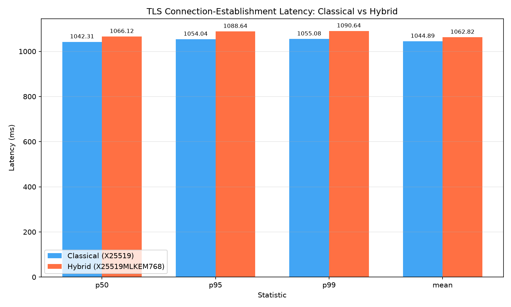
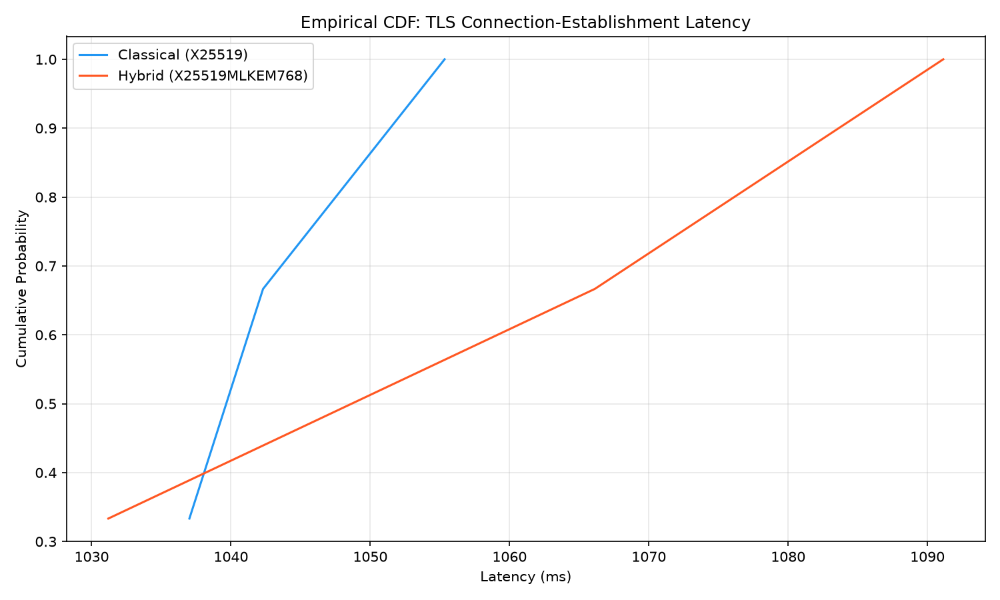
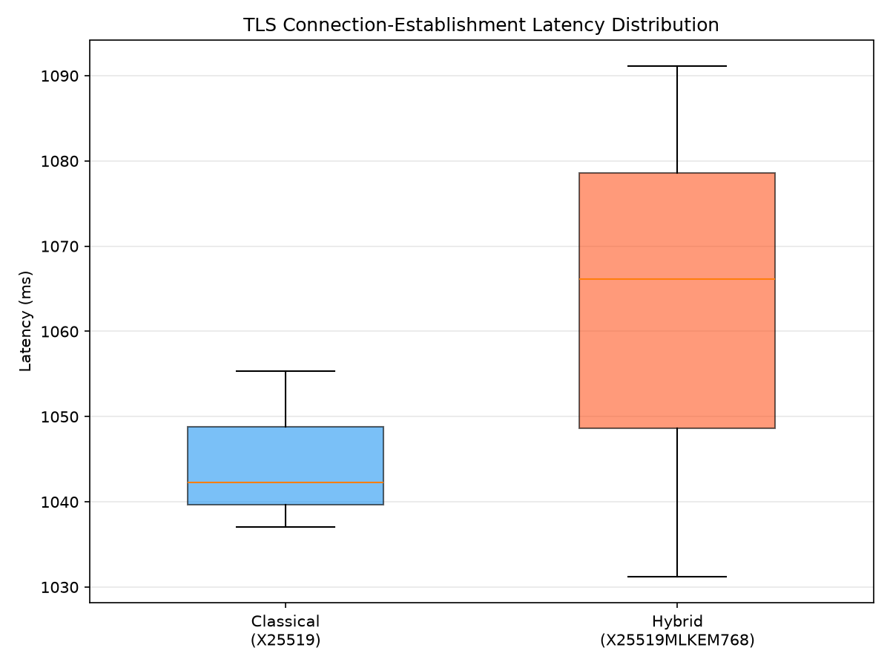

# Week 2 TLS Benchmark — Comparative Analysis Report

Generated: 2026-10-28T11:02:34.286085+00:00

## Executive Summary

Hybrid TLS (X25519MLKEM768) showed a median (p50) latency that was 23.8174 ms higher than classical TLS (X25519), representing a 2.29% overhead.

## Experimental Setup

### Classical Run
- Run ID: local-classical-openssl41-smoke
- Target: 127.0.0.1:18445
- Expected group: X25519
- Python: 3.13.12 (tags/v3.13.12:1cbe481, Feb  3 2026, 18:22:25) [MSC v.1944 64 bit (AMD64)]
- Python OpenSSL backend: OpenSSL 3.0.18 30 Sep 2025
- OpenSSL client: not recorded
- OS: Windows 11
- Warmup: 1
- Measured: 3
- Timeout: 10.0s
- Timing: Connection-establishment latency: from immediately before openssl s_client starts through direct TLS 1.3 group and certificate verification. Includes client process startup and TCP setup.

### Hybrid Run
- Run ID: local-hybrid-openssl41-smoke
- Target: 127.0.0.1:18444
- Expected group: X25519MLKEM768
- Python: 3.13.12 (tags/v3.13.12:1cbe481, Feb  3 2026, 18:22:25) [MSC v.1944 64 bit (AMD64)]
- Python OpenSSL backend: OpenSSL 3.0.18 30 Sep 2025
- OpenSSL client: not recorded
- OS: Windows 11
- Warmup: 1
- Measured: 3
- Timeout: 10.0s
- Timing: Connection-establishment latency: from immediately before openssl s_client starts through direct TLS 1.3 group and certificate verification. Includes client process startup and TCP setup.

## Results

| Metric | Classical (X25519) | Hybrid (X25519MLKEM768) |
| --- | --- | --- |
| Total attempts | 3 | 3 |
| Successful | 3 | 3 |
| Failed | 0 | 0 |
| Success rate | 100.0% | 100.0% |
| p50 latency (ms) | 1042.3057 | 1066.1231 |
| p95 latency (ms) | 1054.0361 | 1088.6357 |
| p99 latency (ms) | 1055.0788 | 1090.6368 |
| Mean latency (ms) | 1044.8879 | 1062.8202 |
| Std deviation (ms) | 9.4295 | 30.1045 |
| Min latency (ms) | 1037.0184 | 1031.2004 |
| Max latency (ms) | 1055.3395 | 1091.1371 |

## Comparative Analysis

| Percentile | Abs. Difference (ms) | Relative Overhead (%) |
| --- | --- | --- |
| p50 | 23.8174 | 2.2851 |
| p95 | 34.5996 | 3.2826 |
| p99 | 35.5580 | 3.3702 |
| mean | 17.9323 | 1.7162 |

Relative overhead (%) = ((hybrid - classical) / classical) × 100. Positive values indicate hybrid is slower.

## Charts







## Limitations

- Each accepted input row has OpenSSL-reported TLS 1.3, certificate, and named-group evidence.
- Timing includes OpenSSL client startup and TCP setup (connection-establishment latency, not pure handshake).
- Results apply only to the specific endpoint, hardware, and software versions tested.
- Loopback connections do not measure realistic network conditions.
- No packet capture or handshake-size data was collected.

## Reproduction Instructions

```powershell
$python = python
& $python scripts/benchmark_tls.py --mode classical --host HOST --port PORT --ca-file CA --openssl-path /path/to/openssl --warmup 100 --iterations 1000 --output-dir results/week2/classical-verified
& $python scripts/benchmark_tls.py --mode hybrid --host HOST --port PORT --ca-file CA --openssl-path /path/to/openssl --warmup 100 --iterations 1000 --output-dir results/week2/hybrid-verified
& $python scripts/analyze_tls_results.py --classical-csv results/week2/classical-full/raw.csv --hybrid-csv results/week2/hybrid-full/raw.csv --output-dir results/week2/comparison
```
